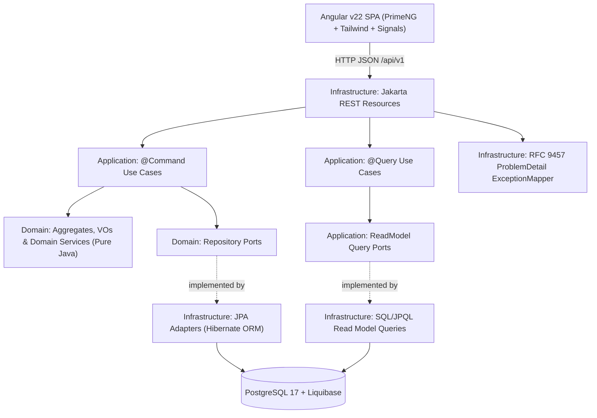
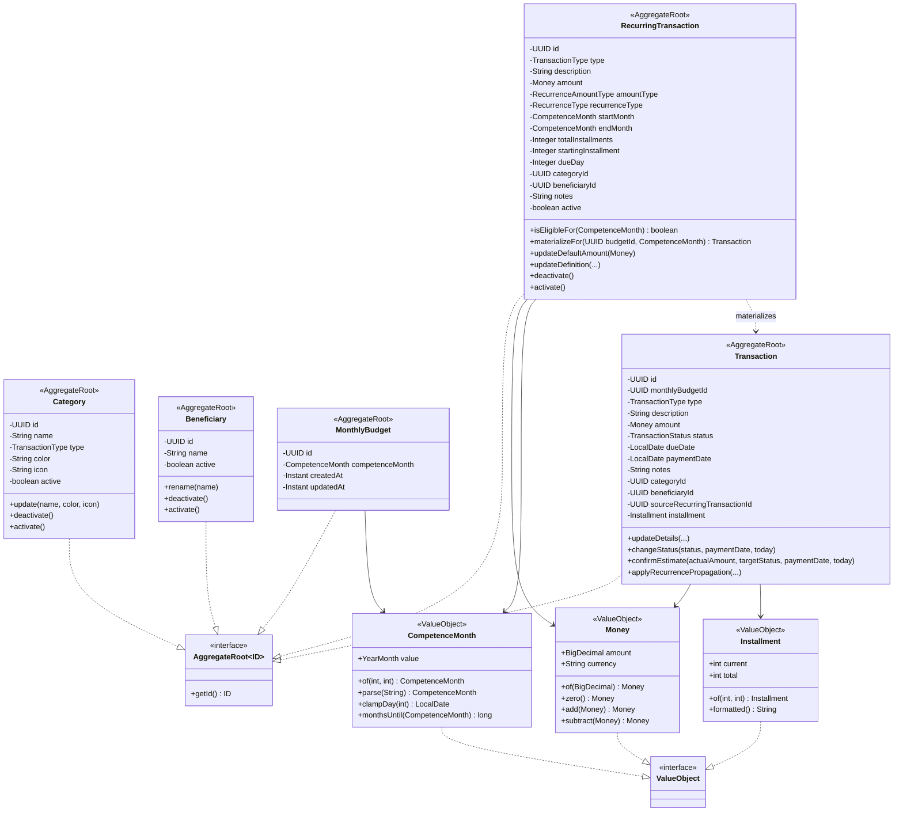
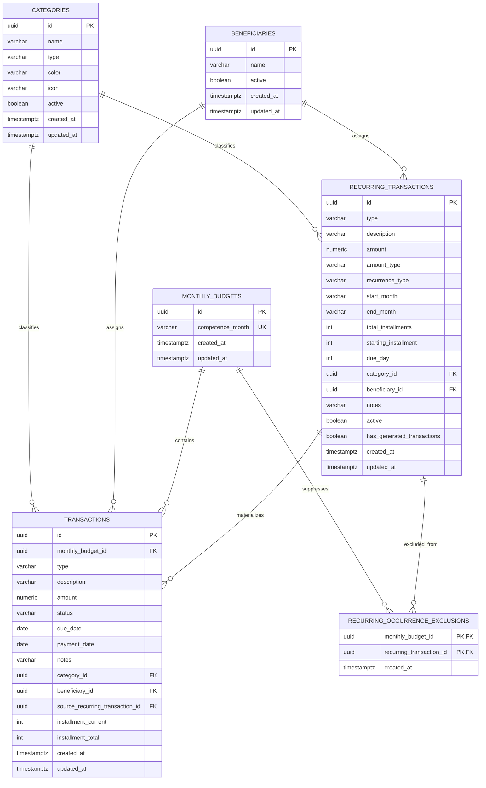
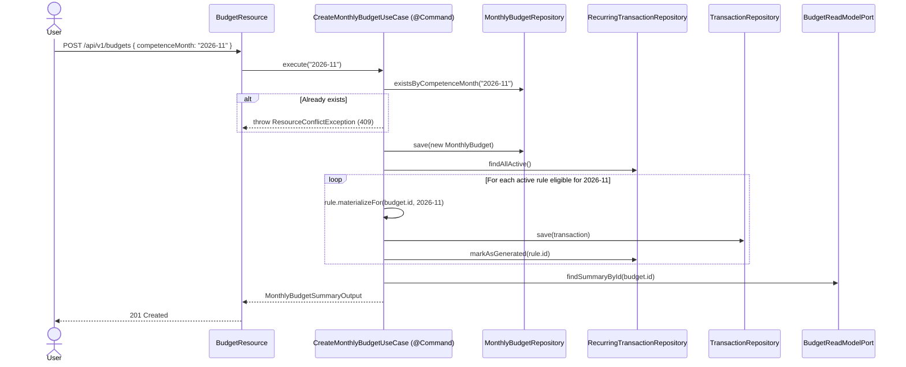
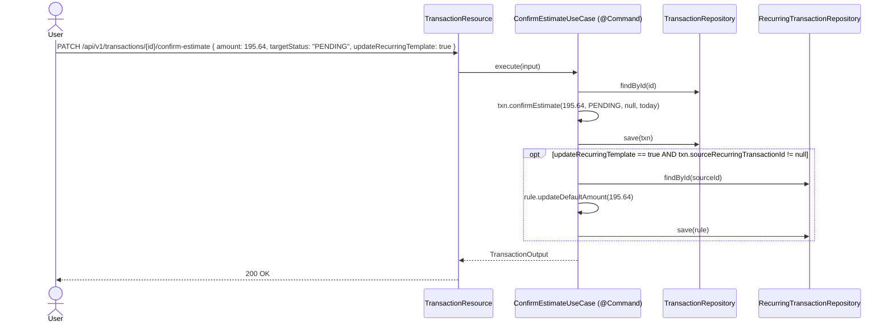

# Lumo MVP Design

**Spec**: `.specs/features/01-lumo-mvp/spec.md`
**Status**: Approved
**Approved**: 2026-11-26 - user: "está aprovado"

---

## Architecture Overview

O **Lumo** é estruturado como monorepo com dois projetos independentes (`backend/` e `frontend/`) e `docker-compose.yml` na raiz para execução local do PostgreSQL e da aplicação.

O backend segue **Clean Architecture + Domain-Driven Design (DDD)** sobre **Java 25 + Quarkus 3.33 LTS (`3.33.4.2`) + Maven**:
- **`domain`** (100% Java puro): Aggregate Roots, Entities, Value Objects, Domain Services, Domain Exceptions, portas de repositório e estereótipos (`AggregateRoot`, `Entity<T>`, `ValueObject`). Zero dependência de Quarkus, Jakarta CDI, JPA ou Jackson.
- **`application`**: Casos de uso granulares separados em comandos (`@Command`) e consultas (`@Query`), DTOs de entrada/saída, `Clock` injetável e portas de leitura (Read Models). Depende exclusivamente de `domain` e anotações de estereótipo da camada `application`.
- **`infrastructure`**: Recursos REST Jakarta REST (`/api/v1`), adaptadores de persistência Hibernate ORM / JPA, queries agregadas de Read Model, migrations Liquibase em SQL formatado, `ExceptionMapper` RFC 9457 (`application/problem+json`) e configurações Quarkus.

O frontend segue **Angular v22 (Standalone Components + Signals)** + **Tailwind CSS** + **PrimeNG v22**, consumindo `/api/v1` via serviços HTTP tipados e estado local/por domínio baseado em `signal` e `computed`.



### Repository & Package Layout

```text
lumo-app/
├── docker-compose.yml
├── backend/
│   ├── pom.xml                                  # Quarkus 3.33.4.2 LTS, Java 25, Maven
│   └── src/
│       ├── main/
│       │   ├── java/io/github/tiaggofg/lumo/
│       │   │   ├── domain/
│       │   │   │   ├── stereotype/              # AggregateRoot, Entity<T>, ValueObject
│       │   │   │   ├── shared/                  # Money, CompetenceMonth, Installment, DomainException hierarchy
│       │   │   │   ├── catalog/                 # Category, Beneficiary + Repository Ports
│       │   │   │   ├── budget/                  # MonthlyBudget + Repository Port
│       │   │   │   ├── transaction/             # Transaction, TransactionType, TransactionStatus + Repository Port
│       │   │   │   └── recurrence/              # RecurringTransaction, RecurrenceType, RecurrenceAmountType, RecurringMaterializer
│       │   │   ├── application/
│       │   │   │   ├── stereotype/              # @Command, @Query, @ReadOnlyTransaction
│       │   │   │   ├── catalog/                 # Category & Beneficiary use cases
│       │   │   │   ├── budget/                  # MonthlyBudget use cases + BudgetReadModelPort
│       │   │   │   ├── transaction/             # Transaction use cases + TransactionQueryPort
│       │   │   │   └── recurrence/              # RecurringTransaction use cases + OccurrenceExclusionPort
│       │   │   └── infrastructure/
│       │   │       ├── config/                  # ClockProducer, ReadOnlyTransactionInterceptor, ObjectMapperCustomizer
│       │   │       ├── web/                     # REST Resources (/api/v1/*), Request/Response DTOs, ProblemDetailMapper
│       │   │       └── persistence/             # JPA Entities, Mappers, Repository Adapters, ReadModel Adapters
│       │   └── resources/
│       │       ├── application.properties
│       │       └── db/changelog/                # db.changelog-master.yaml + SQL formatado (001..00N)
│       └── test/
│           └── java/io/github/tiaggofg/lumo/
│               ├── architecture/                # CleanArchitectureArchTest (ArchUnit)
│               ├── domain/                      # Unitários puros (sem Quarkus)
│               ├── application/                 # Unitários de casos de uso com fakes/mocks
│               └── infrastructure/web/          # Testes de integração (@QuarkusTest + Testcontainers PostgreSQL)
├── frontend/
│   ├── angular.json / package.json
│   ├── e2e/                                     # Playwright E2E specs (desktop + mobile)
│   └── src/app/
│       ├── core/                                # API config, HTTP ProblemDetail interceptor, ThemeService, Shell layout
│       ├── shared/                              # BRL currency pipe, Status badge component, ConfirmDialog helpers
│       └── features/
│           ├── budgets/                         # Listagem, Detalhe, Summary Cards, Charts, Transaction Table/Cards, Modals
│           ├── recurrences/                     # Listagem, Create/Edit/Deactivate dialogs
│           └── catalog/                         # Tabs Categorias e Beneficiários
├── docs/
└── .specs/features/01-lumo-mvp/
```

---

## Code Reuse Analysis

O projeto é **greenfield** (sem código de aplicação prévio no repositório). Os ativos existentes reutilizados são:

| Component | Location | How to Use |
| --- | --- | --- |
| Harness Quality Check | `.agents/scripts/quality-check.sh` | Executar lint + SonarQube local antes de concluir o ciclo |
| Feature & Commit Validators | `.agents/scripts/validate-feature-name.sh`, `.agents/scripts/validate-commit-msg.sh` | Validar nomes de feature e mensagens Angular Conventional Commits |
| SonarQube Config | `sonar-project.properties`, `.sonarqube/` | Configurar paths `backend/src/main/java` e `frontend/src` ao inicializar os projetos |
| Spec State & ADRs | `.specs/STATE.md` | Manter `AD-001`..`AD-008` como fonte de verdade arquitetural |

---

## Domain Model & DDD Architecture

### Stereotypes

- `domain.stereotype.Entity<ID>` — interface com `ID getId()` (identidade explícita).
- `domain.stereotype.AggregateRoot<ID>` — estende `Entity<ID>`, marca a raiz de consistência transacional.
- `domain.stereotype.ValueObject` — interface marcadora para VOs imutáveis (Java `record`).
- `application.stereotype.Command` — `@Stereotype` + `@ApplicationScoped` + `@Transactional` (Jakarta JTA `REQUIRED`).
- `application.stereotype.Query` — `@Stereotype` + `@ApplicationScoped` + `@Transactional(SUPPORTS)` + `@ReadOnlyTransaction` (interceptor CDI que configura `FlushModeType.MANUAL` / sessão Hibernate read-only quando ativa, impedindo dirty-checking em consultas).

### Class Diagram



### Invariantes Críticas do Domínio

1. **`Money`**: escala sempre `2` (`RoundingMode.HALF_UP`), moeda fixa `"BRL"`. `Money.positive(amount)` rejeita `null` ou `<= 0` com `DomainValidationException`. `Money.zero()` existe apenas para agregações de Read Model.
2. **`CompetenceMonth`**: envolve `YearMonth` (formato ISO `YYYY-MM`). `clampDay(dueDay)` calcula `value.atDay(Math.min(dueDay, value.lengthOfMonth()))`.
3. **`Installment`**: exige `total >= 2` e `1 <= current <= total`.
4. **`Transaction`**:
   - `monthlyBudgetId` é atribuído na criação e não possui setter/método de alteração.
   - Transição para `SETTLED`: se `paymentDate` não for informado, assume `today` (injetado via `Clock`).
   - Reversão de `SETTLED` para `PENDING` ou `ESTIMATED`: obrigatoriamente define `paymentDate = null`.
   - `confirmEstimate(actualAmount, targetStatus, paymentDate, today)`: só pode ser invocado quando `status == ESTIMATED`, `targetStatus` deve ser `PENDING` ou `SETTLED`, e `actualAmount > 0`.
   - `applyRecurrencePropagation(...)`: rejeita silenciosamente ou lança guarda de domínio se `status == SETTLED` (a query de busca já filtra apenas `ESTIMATED`/`PENDING`, e o domínio reforça a invariante).
5. **`RecurringTransaction`**:
   - `INDEFINITE`: `endMonth == null`, `totalInstallments == null`, `startingInstallment == null`. Elegível para qualquer `month >= startMonth`.
   - `FIXED_TERM`: `endMonth != null && !endMonth.isBefore(startMonth)`, `totalInstallments == null`, `startingInstallment == null`. Elegível para `startMonth <= month <= endMonth`.
   - `INSTALLMENT`: `totalInstallments >= 2`, `startingInstallment` default `1` (`1 <= startingInstallment <= totalInstallments`), `endMonth` derivado como `startMonth.plusMonths(totalInstallments - startingInstallment)`. Elegível para `0 <= monthsBetween(startMonth, month) <= (totalInstallments - startingInstallment)`, produzindo `Installment.of(startingInstallment + offset, totalInstallments)`.
   - `dueDay`: opcional; se presente, `1 <= dueDay <= 31`.
   - `materializeFor(budgetId, month)`: valida elegibilidade e `active == true`, define `status = (amountType == FIXED) ? PENDING : ESTIMATED`, calcula `dueDate = dueDay != null ? month.clampDay(dueDay) : null`, e gera nova `Transaction` com `sourceRecurringTransactionId = this.id`.

---

## Data Models & Database Schema

Todas as migrations ficam em `backend/src/main/resources/db/changelog/` usando **Liquibase SQL formatado** (`--liquibase formatted sql`).



### Constraints & Indexes Chave
- `categories`: `UNIQUE (LOWER(name), type)`, `CHECK (type IN ('INCOME', 'EXPENSE'))`.
- `beneficiaries`: `UNIQUE (LOWER(name))`.
- `monthly_budgets`: `UNIQUE (competence_month)`, `CHECK (competence_month ~ '^[0-9]{4}-(0[1-9]|1[0-2])$')`.
- `recurring_transactions`:
  - `CHECK (amount > 0)`, `CHECK (due_day IS NULL OR due_day BETWEEN 1 AND 31)`.
  - `has_generated_transactions` (`boolean NOT NULL DEFAULT FALSE`) garante que mesmo se todas as transações geradas forem excluídas depois, a regra de negócio de `REC-03` ("nunca gerou transações") permaneça exata.
- `transactions`:
  - `CHECK (amount > 0)`, `CHECK (status IN ('ESTIMATED', 'PENDING', 'SETTLED'))`, `CHECK (type IN ('INCOME', 'EXPENSE'))`.
  - Índice único parcial: `UNIQUE (monthly_budget_id, source_recurring_transaction_id) WHERE source_recurring_transaction_id IS NOT NULL` — garante idempotência absoluta de materialização no banco.
  - Índice de Read Model: `INDEX idx_transactions_budget_type_status ON transactions (monthly_budget_id, type, status)`.
  - Índice de ordenação: `INDEX idx_transactions_budget_order ON transactions (monthly_budget_id, due_date ASC NULLS LAST, created_at ASC)`.
- `recurring_occurrence_exclusions`:
  - `PRIMARY KEY (monthly_budget_id, recurring_transaction_id)`.
  - `ON DELETE CASCADE` em `monthly_budget_id` (quando um orçamento vazio é excluído, remove suas linhas de supressão).
- **Seed inicial (`002-seed-catalog.sql`)**:
  - Categorias `EXPENSE`: `Moradia`, `Contas Básicas`, `Cartão de Crédito`, `Saúde`, `Educação`, `Alimentação`, `Transporte`, `Lazer`, `Outros` (com cores hex e ícones PrimeIcons padrão).
  - Categorias `INCOME`: `Salário`, `Renda Extra`, `Outros`.
  - Beneficiário padrão: `Família`.

---

## Key Interaction Flows

### 1. Criação de `MonthlyBudget` + Materialização Automática



### 2. Confirmação de Transação `ESTIMATED` + Atualização Opcional de Template



---

## REST API Contracts (`/api/v1`)

Todas as respostas de erro seguem **RFC 9457 (`application/problem+json`)**:
```json
{
  "type": "https://lumo.local/problems/resource-conflict",
  "title": "Resource Conflict",
  "status": 409,
  "detail": "MonthlyBudget already exists for competence 2026-11.",
  "instance": "/api/v1/budgets",
  "errors": [
    { "field": "amount", "message": "must be greater than 0" }
  ]
}
```
*(O array `errors` é incluído apenas em erros de validação `400`.)*

### Catalog Endpoints

| Method | Path | Query / Body | Response |
| --- | --- | --- | --- |
| `GET` | `/api/v1/categories` | `?type=INCOME\|EXPENSE&active=true\|false` | `200 OK` lista ordenada por `name ASC` |
| `POST` | `/api/v1/categories` | `{ name, type, color?, icon? }` | `201 Created`, `400`, `409` |
| `PUT` | `/api/v1/categories/{id}` | `{ name, color?, icon? }` | `200 OK`, `400`, `404`, `409` |
| `PATCH` | `/api/v1/categories/{id}/status` | `{ active: boolean }` | `200 OK`, `404` |
| `DELETE` | `/api/v1/categories/{id}` | — | `204 No Content`, `404`, `409` (se em uso) |
| `GET` | `/api/v1/beneficiaries` | `?active=true\|false` | `200 OK` lista ordenada por `name ASC` |
| `POST` | `/api/v1/beneficiaries` | `{ name }` | `201 Created`, `400`, `409` |
| `PUT` | `/api/v1/beneficiaries/{id}` | `{ name }` | `200 OK`, `400`, `404`, `409` |
| `PATCH` | `/api/v1/beneficiaries/{id}/status` | `{ active: boolean }` | `200 OK`, `404` |
| `DELETE` | `/api/v1/beneficiaries/{id}` | — | `204 No Content`, `404`, `409` (se em uso) |

### MonthlyBudget Endpoints

| Method | Path | Query / Body | Response |
| --- | --- | --- | --- |
| `GET` | `/api/v1/budgets` | — | `200 OK` lista ordenada por `competenceMonth DESC` com `summary` (6 valores Previsto/Realizado) e `transactionCount` |
| `POST` | `/api/v1/budgets` | `{ competenceMonth: "YYYY-MM" }` | `201 Created` (inclui `materializedCount` + `summary`), `400`, `409` |
| `GET` | `/api/v1/budgets/{id}` | — | `200 OK` com `summary`, `statusCounts` (`estimated`, `pending`, `settled`), `expensesByCategory[]`, `expensesByBeneficiary[]` |
| `DELETE` | `/api/v1/budgets/{id}` | — | `204 No Content`, `404`, `409` (se houver transações) |

### Transaction Endpoints

| Method | Path | Query / Body | Response |
| --- | --- | --- | --- |
| `GET` | `/api/v1/budgets/{budgetId}/transactions` | `?type=&status=&categoryId=&beneficiaryId=&search=` | `200 OK` lista ordenada por `dueDate ASC NULLS LAST, createdAt ASC`, incluindo resumo denormalizado de `categoryName`/`categoryColor` e `beneficiaryName` |
| `POST` | `/api/v1/budgets/{budgetId}/transactions` | `{ type, description, amount, status, dueDate?, paymentDate?, notes?, categoryId?, beneficiaryId? }` | `201 Created`, `400`, `404`, `422` |
| `PUT` | `/api/v1/transactions/{id}` | `{ type, description, amount, status, dueDate?, paymentDate?, notes?, categoryId?, beneficiaryId? }` | `200 OK`, `400`, `404`, `422` |
| `PATCH` | `/api/v1/transactions/{id}/status` | `{ status: "ESTIMATED"\|"PENDING"\|"SETTLED", paymentDate? }` | `200 OK`, `400`, `404` |
| `PATCH` | `/api/v1/transactions/{id}/confirm-estimate` | `{ amount, targetStatus: "PENDING"\|"SETTLED", paymentDate?, updateRecurringTemplate?: boolean }` | `200 OK`, `400`, `404`, `422` |
| `DELETE` | `/api/v1/transactions/{id}` | — | `204 No Content`, `404` (registra supressão se `sourceRecurringTransactionId != null`) |

### RecurringTransaction Endpoints

| Method | Path | Query / Body | Response |
| --- | --- | --- | --- |
| `GET` | `/api/v1/recurring-transactions` | `?active=&type=&recurrenceType=` | `200 OK` lista ordenada por `active DESC, description ASC` |
| `POST` | `/api/v1/recurring-transactions` | `{ type, description, amount, amountType, recurrenceType, startMonth, endMonth?, totalInstallments?, startingInstallment?, dueDay?, categoryId?, beneficiaryId?, notes? }` | `201 Created` (inclui `materializedBudgetIds[]`), `400`, `404`, `422` |
| `PUT` | `/api/v1/recurring-transactions/{id}` | `{ ...definition, propagateToOpenTransactions?: boolean }` | `200 OK` (inclui `propagatedCount`), `400`, `404`, `422` |
| `PATCH` | `/api/v1/recurring-transactions/{id}/deactivate` | `{ removeFutureOpenTransactions?: boolean }` | `200 OK` (inclui `removedTransactionsCount`), `404` |
| `PATCH` | `/api/v1/recurring-transactions/{id}/activate` | — | `200 OK`, `404` |
| `DELETE` | `/api/v1/recurring-transactions/{id}` | — | `204 No Content`, `404`, `409` (se já gerou transações) |

---

## Frontend Architecture, Wireframes & Screen Flows

### Navegação e Layout Shell

- **Rotas**:
  - `/` -> redireciona para `/budgets`
  - `/budgets` -> Lista de Orçamentos Mensais
  - `/budgets/:id` -> Detalhe do Orçamento Mensal (substitui a planilha)
  - `/recurrences` -> Gestão de Recorrências
  - `/catalog` -> Gestão de Categorias e Beneficiários (abas)
- **Responsividade & Tema**:
  - Desktop (`>= 1024px`): Sidebar fixa à esquerda (Lumo logo + 3 links: Orçamentos, Recorrências, Cadastros) + Header superior com breadcrumb/título e toggle Light/Dark Mode.
  - Mobile (`< 768px`): Top bar com botão de menu (drawer lateral) + toggle tema; tabelas viram lista de cards empilhados com ação 1-clique em destaque.
  - Números monetários sempre com `font-variant-numeric: tabular-nums` e formatação `pt-BR` (`R$ 6.178,42`).

### Wireframe 1 — `/budgets` (Orçamentos Mensais)

```text
+-------------------------------------------------------------------------+
| [Lumo]  Orçamentos Mensais                   [☀/🌙]  [+ Novo Orçamento] |
+-------------------------------------------------------------------------+
|  +---------------------------+   +---------------------------+          |
|  | Novembro 2026      [🗑]   |   | Outubro 2026       [🗑]   |          |
|  | Receitas:  R$ 6.362,29    |   | Receitas:  R$ 6.362,29    |          |
|  | Despesas:  R$ 6.178,42    |   | Despesas:  R$ 5.910,00    |          |
|  | Saldo Prev:  R$ 183,87    |   | Saldo Prev:  R$ 452,29    |          |
|  | Realizado:   R$ 333,87    |   | Realizado:   R$ 452,29    |          |
|  | [██████████░] 97% pago    |   | [███████████] 100% pago   |          |
|  +---------------------------+   +---------------------------+          |
+-------------------------------------------------------------------------+
```

### Wireframe 2 — `/budgets/:id` (Detalhe do Orçamento Mensal)

```text
+-------------------------------------------------------------------------------+
| ← Orçamentos / Novembro 2026                   [+ Novo Lançamento]  [☀/🌙]    |
+-------------------------------------------------------------------------------+
| [ Receitas              ] [ Despesas              ] [ Saldo                 ] |
| [ Prev: R$ 6.362,29     ] [ Prev: R$ 6.178,42     ] [ Prev:  + R$ 183,87    ] |
| [ Real: R$ 6.362,29     ] [ Real: R$ 6.028,42     ] [ Real:  + R$ 333,87    ] |
|                           [ ████████████░ 97,5% pago ]                        |
+-------------------------------------------------------------------------------+
| Abas: [ Todas (14) | Despesas (13) | Receitas (1) ]                           |
| Filtros: [Buscar...] [Status ▾] [Categoria ▾] [Beneficiário ▾] [Limpar]       |
+-------------------------------------------------------------------------------+
| Status(1-click) | Descrição / Obs       | Cat / Benef | Venc   | Valor | Ações|
|-------------------------------------------------------------------------------|
| [✓ Pago]        | Aluguel (↻)           | Moradia/Fam | 05/11  | 800,00| ✎ 🗑 |
| [○ Pendente]    | Dentista - Jéssica    | Saúde/Jés   | 15/11  | 150,00| ✎ 🗑 |
| [~ Estimado]    | Água (↻) [Confirmar]  | Contas/Fam  | 20/11  | 180,00| ✎ 🗑 |
| [✓ Pago]        | Cartão Sogra (4/6 ↻)  | Cartão/Fam  |  —     |  58,66| ✎ 🗑 |
+-------------------------------------------------------------------------------+
| [ Gráfico: Despesas por Categoria ]   [ Gráfico: Despesas por Beneficiário ]  |
+-------------------------------------------------------------------------------+
```

### Wireframe 3 — `/recurrences` & `/catalog`

- **`/recurrences`**: Header + filtros (`Ativas/Inativas`, `Tipo`, `Modo`) + botão `[+ Nova Recorrência]`. Cada item mostra descrição, valor (`Fixo` ou `Estimado`), badge de modo (`Indefinida`, `Até 11/2026`, `Parcela 4/6`), `dueDay`, categoria, beneficiário e ações (`Editar`, `Desativar/Reativar`, `Excluir`). Modal de edição inclui checkbox *"Propagar alterações para lançamentos em aberto (mês atual e futuros)"*. Modal de desativação inclui checkbox *"Remover lançamentos futuros em aberto"*.
- **`/catalog`**: Duas abas (`Categorias` | `Beneficiários`). Em Categorias: agrupamento/filtro por `Despesas` e `Receitas`, chip colorido, toggle `Ativa/Inativa`, edição e exclusão com confirmação. Em Beneficiários: lista simples com toggle `Ativo/Inativo`, renomear e excluir.

---

## Components

### Backend Components

| Component | Location | Responsibility |
| --- | --- | --- |
| Domain Stereotypes & Shared VOs | `domain/stereotype/`, `domain/shared/` | `AggregateRoot`, `Entity<T>`, `ValueObject`, `Money`, `CompetenceMonth`, `Installment`, exceções de domínio |
| Catalog Module | `domain/catalog/`, `application/catalog/`, `infrastructure/web/catalog/` | CRUD + soft-disable + bloqueio de exclusão em uso para `Category` e `Beneficiary` |
| Budget Module | `domain/budget/`, `application/budget/`, `infrastructure/web/budget/` | Criação de `MonthlyBudget` (disparando materialização), exclusão segura e Read Model de resumo + breakdowns |
| Transaction Module | `domain/transaction/`, `application/transaction/`, `infrastructure/web/transaction/` | CRUD, filtros, transição de status (`paymentDate`), `confirmEstimate` e registro de supressão ao excluir recorrente |
| Recurrence Module | `domain/recurrence/`, `application/recurrence/`, `infrastructure/web/recurrence/` | Regras `INDEFINITE`/`FIXED_TERM`/`INSTALLMENT`, materialização idempotente, edição com propagação opt-in, desativação/exclusão |
| Cross-cutting Infrastructure | `infrastructure/config/`, `infrastructure/web/error/` | `ClockProducer`, `ReadOnlyTransactionInterceptor`, `ProblemDetailExceptionMapper`, OpenAPI config |

### Frontend Components

| Component | Location | Responsibility |
| --- | --- | --- |
| Core Shell & Theme | `core/layout/`, `core/services/theme.service.ts` | Navegação responsiva, `ThemeService` (`localStorage` + classe `dark`), `problemDetailInterceptor` |
| Budgets Feature | `features/budgets/` | `BudgetsStoreService` (Signals), `BudgetListPage`, `BudgetDetailPage`, `BudgetSummaryCards`, `TransactionTable`, `ConfirmEstimateDialog`, `BudgetCharts` |
| Recurrences Feature | `features/recurrences/` | `RecurrencesStoreService`, `RecurrencesPage`, `RecurrenceFormDialog`, `DeactivateRecurrenceDialog` |
| Catalog Feature | `features/catalog/` | `CatalogStoreService`, `CatalogPage` (tabs Categorias e Beneficiários) |

---

## Error Handling Strategy

| Domain / Infra Exception | HTTP Status | RFC 9457 `type` | User Impact (UI) |
| --- | --- | --- | --- |
| `DomainValidationException` / Bean Validation | `400 Bad Request` | `.../validation-error` | Mensagem inline nos campos do formulário + toast |
| `ResourceNotFoundException` | `404 Not Found` | `.../not-found` | Toast de aviso ou estado "Não encontrado" na rota |
| `ResourceConflictException` / DB Unique Violation | `409 Conflict` | `.../resource-conflict` | Toast explicando o motivo (ex: orçamento duplicado, item em uso) |
| `BusinessRuleViolationException` (ex: categoria inativa, `confirmEstimate` em não-`ESTIMATED`) | `422 Unprocessable Content` | `.../business-rule-violation` | Toast com a regra violada |
| Exceções inesperadas | `500 Internal Server Error` | `.../internal-error` | Log com stacktrace no servidor; mensagem genérica segura na UI |

---

## Verification & Architectural Guardrails

### ArchUnit Rules (`CleanArchitectureArchTest`)
1. `domain..` não deve acessar `io.quarkus..`, `jakarta..`, `org.hibernate..`, `com.fasterxml..`, `application..` nem `infrastructure..`.
2. `application..` não deve acessar `infrastructure..` nem `jakarta.persistence..` nem `jakarta.ws.rs..`.
3. Classes anotadas com `@Command` ou `@Query` devem residir em `..application..`.
4. Toda classe concreta em `..domain..` implementando `AggregateRoot` não pode conter anotações JPA (`@Entity`, `@Table`).

### Test Pyramid
- **Unitários Puros (`backend`)**: JUnit 5 + AssertJ em `domain` (VOs, cálculos de parcela/clamp, transições de status) e `application` (casos de uso com fakes em memória).
- **ArchUnit (`backend`)**: Regras de camadas e estereótipos executadas na suíte `mvn test`.
- **Integração (`backend`)**: `@QuarkusTest` + Testcontainers PostgreSQL (via Quarkus Dev Services / Testcontainers explícito) validando Liquibase + JPA + Read Model SQL + REST API + RFC 9457 em todos os endpoints.
- **Unitários (`frontend`)**: Testes de serviços Signals, pipes BRL/Status e componentes críticos (`npm test`).
- **E2E (`frontend/e2e`)**: Playwright rodando sobre backend + frontend reais em desktop (`1440x900`) e mobile (`390x844`), cobrindo o fluxo completo da planilha do usuário sem erros de console.

---

## Risks & Concerns

| Concern | Location | Impact | Mitigation |
| --- | --- | --- | --- |
| Termos de licença comercial de componentes avançados do PrimeNG v22 | `frontend/package.json` | Risco de usar componente pago sem perceber | Restringir uso estritamente a componentes MIT/gratuitos do PrimeNG (Table, Dialog, Select, InputNumber, Tag, Tabs, Toast, ConfirmDialog, Chart.js) e validar `package.json`/licença em T24; fallback para Tailwind + Angular CDK se necessário |
| `jakarta.transaction.Transactional` não oferece `readOnly = true` nativo | `application/stereotype/Query.java` | Consultas poderiam disparar dirty-checking desnecessário do Hibernate | Implementar `@ReadOnlyTransaction` interceptor CDI no Quarkus definindo `FlushModeType.MANUAL` / `Session.setDefaultReadOnly(true)` e usar projeções DTO/native/JPQL no Read Model |
| Corrida concorrente na criação de `MonthlyBudget` ou `Category` com mesmo nome | `infrastructure/persistence/` | Exceção SQL de `unique_violation` (`23505`) vazando como HTTP 500 | Mapear `ConstraintViolationException` / SQLState `23505` no `ProblemDetailExceptionMapper` para HTTP `409 Conflict` |
| Divergência de timezone na definição de `currentMonth` e `today` | `infrastructure/config/ClockProducer.java` | Propagação/materialização pode considerar mês errado próximo à meia-noite UTC | Injetar `Clock` centralizado com `ZoneId` configurável (`lumo.timezone=America/Sao_Paulo`) e fixar `Clock` determinístico nos testes |

---

## Tech Decisions

| Decision | Choice | Rationale |
| --- | --- | --- |
| Backend Runtime | Quarkus `3.33.4.2` (LTS) + Java 25 + Maven | Baixo footprint de RAM (~100–160 MB JVM), LTS com suporte oficial a Java 25, Dev Services e caminho limpo para Native Image |
| RFC 9457 no Quarkus | `ProblemDetailExceptionMapper` próprio (`application/problem+json`) | Zero dependência externa frágil, controle total do contrato e compatível com Native Image |
| Persistência JPA | `quarkus-hibernate-orm` com entidades JPA separadas do domínio (`*JpaEntity`) | Preserva `domain` 100% puro sem anotações JPA, verificado por ArchUnit |
| Gráficos no Frontend | `chart.js` (via PrimeNG `p-chart` ou canvas wrapper fino) | Leve, responsivo, suporta Light/Dark mode via tokens CSS e cobre rosca/barras sem dependência pesada |
| Identidade de Supressão | Tabela `recurring_occurrence_exclusions (monthly_budget_id, recurring_transaction_id)` | Determinística, limpa e impede recriação de transação excluída pontualmente no mês sem soft-delete em `transactions` |
