# ZardUI Migration, Visual Depth, Collapsible Shell & Brand Identity Design

**Spec**: `.specs/features/03-zardui-brand-and-shell/spec.md`
**Context**: `.specs/features/03-zardui-brand-and-shell/context.md`
**Status**: Approved

---

## Architecture Overview

```mermaid
flowchart TD
    subgraph Shell["AppShellComponent (h-dvh Sticky Dark Sidebar + Fluid Main)"]
        Logo["<app-lumo-logo variant='full' | 'mark'>"]
        Sidebar["Desktop Sidebar (w-68 Expanded / w-20 Collapsed Rail)"]
        ToastVP["<z-toast-viewport />"]
        ConfirmDlg["<z-confirm-dialog />"]
    end

    subgraph ZardUI["ZardUI Component Suite (frontend/src/app/shared/ui/)"]
        ZBtn["ZButtonComponent (z-button)"]
        ZDlg["ZDialogComponent (z-dialog)"]
        ZSel["ZSelectComponent (z-select)"]
        ZInp["ZInputDirective ([zInput]) & ZTextareaDirective ([zTextarea])"]
        ZNum["ZInputNumberComponent (z-input-number)"]
        ZChk["ZCheckboxComponent (z-checkbox)"]
        ZTip["ZTooltipDirective ([zTooltip])"]
        ZBdg["ZBadgeComponent (z-badge)"]
        ZChart["ZChartContainerComponent (z-chart-container)"]
        ZToastSvc["ZToastService"]
        ZConfSvc["ZConfirmService"]
    end

    subgraph Pages["Feature Pages"]
        Dash["DashboardPageComponent (/dashboard)"]
        BudList["BudgetListPageComponent (/budgets)"]
        BudDet["BudgetDetailPageComponent (/budgets/:id)"]
        RecPage["RecurrencesPageComponent (/recurrences)"]
        CatPage["CatalogPageComponent (/catalog)"]
    end

    Sidebar --> Logo
    Sidebar --> ZTip
    ToastVP --> ZToastSvc
    ConfirmDlg --> ZConfSvc
    Dash --> ZChart
    Dash --> ZSel
    BudList --> ZBtn
    BudList --> ZDlg
    BudList --> ZConfSvc
    BudDet --> ZBtn
    BudDet --> ZSel
    BudDet --> ZInp
    BudDet --> ZNum
    BudDet --> ZChk
    BudDet --> ZTip
    RecPage --> ZBtn
    RecPage --> ZDlg
    RecPage --> ZSel
    RecPage --> ZNum
    RecPage --> ZChk
    CatPage --> ZBtn
    CatPage --> ZDlg
    CatPage --> ZSel
```

A feature `03-zardui-brand-and-shell` substitui integralmente o pacote `primeng` e `@primeuix/themes` por uma camada própria de componentes **ZardUI (estilo shadcn/ui para Angular v22 — 100% MIT)** localizada em `frontend/src/app/shared/ui/`, redesenha o `AppShellComponent` com **Dark Sidebar (`slate-900`)** no Light Mode, altura fixa (`h-dvh sticky top-0`) e modo recolhido (`w-20`) persistido em `localStorage`, introduz a identidade de marca vetorial **Lumo ("Prisma de Luz & Camadas")** (`<app-lumo-logo>` + favicons/manifest), e envolve os 4 gráficos analíticos do `/dashboard` no padrão **ZardUI / shadcn Charts (`<z-chart-container>`)**.



---

## Code Reuse Analysis

### Existing Components to Leverage

| Component / Service | Location | How to Use |
| --- | --- | --- |
| `ThemeService` | `frontend/src/app/core/services/theme.service.ts` | Reutilizar signal `isDark()` para alternar tokens de superfície e cores de canvas Chart.js |
| `problemDetailInterceptor` | `frontend/src/app/core/interceptors/problem-detail.interceptor.ts` | Substituir `inject(MessageService)` por `inject(ZToastService)` mantendo a mesma assinatura `.add({ severity, summary, detail, life })` |
| `LUMO_CHART_PALETTE` & `resolveChartColors` | `frontend/src/app/shared/utils/chart-palette.ts` | Reutilizar a paleta categórica de 10 cores sem verde nos 4 painéis `<z-chart-container>` do `/dashboard` |
| `TransactionStatusBadgeComponent` | `frontend/src/app/shared/components/transaction-status-badge.component.ts` | Integrar com `z-badge` / tokens ZardUI mantendo os status `Pago`, `Recebido`, `Pendente` e `Estimado` |
| Feature Stores (`BudgetsStoreService`, `CatalogStoreService`, `RecurrencesStoreService`) | `frontend/src/app/features/**` | Reutilizar 100% da camada de estado e chamadas HTTP sem alterações de contrato |

### Integration Points

| System | Integration Method |
| --- | --- |
| `app.config.ts` | Remover `providePrimeNG`, `MessageService` e `ConfirmationService`; `ZToastService` e `ZConfirmService` usam `@Injectable({ providedIn: 'root' })` |
| `index.html` & `public/` | Adicionar links para `favicon.svg`, `favicon.ico`, `apple-touch-icon.png`, `site.webmanifest` e `<meta name="theme-color" content="#4F46E5">` |
| `styles.css` | Definir variáveis CSS ZardUI / shadcn (`--z-bg-canvas`, `--z-bg-card`, `--z-bg-sidebar`, `--z-border`, `--z-ring`) para Light Mode (`slate-100` canvas, `slate-900` sidebar, `white` card) e Dark Mode (`slate-950` canvas, `slate-900` sidebar/card) |

---

## 1. Visual Depth & Surface Hierarchy (`SHELL-01`)

Para eliminar o aspecto "tudo branco chapado" no Modo Claro, as superfícies seguem o contraste em 3 camadas estilo Linear/Stripe:

| Camada | Light Mode | Dark Mode (`.dark`) | Classes Tailwind |
| --- | --- | --- | --- |
| **Page Canvas (`body`, `<main>`)** | `#F1F5F9` (`slate-100`) | `#020617` (`slate-950`) | `bg-slate-100 dark:bg-slate-950 text-slate-900 dark:text-slate-100` |
| **Sidebar Desktop & Mobile Drawer** | `#0F172A` (`slate-900`) | `#0F172A` (`slate-900`) | `bg-slate-900 text-slate-100 border-r border-slate-800` |
| **Sidebar Nav Item (Idle / Hover)** | `#94A3B8` → `#F8FAFC` | `#94A3B8` → `#F8FAFC` | `text-slate-300 hover:bg-slate-800/80 hover:text-white` |
| **Sidebar Nav Item (Active)** | `#4F46E5` + glow sutil | `#4F46E5` + glow sutil | `bg-indigo-600 text-white font-semibold shadow-sm shadow-indigo-950/50` |
| **Elevated Cards & Panels** | `#FFFFFF` (`white`) | `#0F172A` (`slate-900`) | `bg-white dark:bg-slate-900 border border-slate-200/90 dark:border-slate-800 shadow-sm` |
| **Table Headers & Sub-bars** | `#F1F5F9` (`slate-100/80`) | `rgba(30, 41, 59, 0.6)` | `bg-slate-100/80 dark:bg-slate-800/60 border-b border-slate-200 dark:border-slate-800` |
| **Form Controls (`z-input`, `z-select`, `z-input-number`)** | `#F8FAFC` → `#FFFFFF` no foco | `#020617` / `#0F172A` | `bg-slate-50/70 focus:bg-white dark:bg-slate-950/60 border-slate-300 dark:border-slate-700 focus:ring-2 focus:ring-indigo-500/30 focus:border-indigo-600` |

---

## 2. Brand Identity & SVG Logo ("Prisma de Luz & Camadas") (`BRAND-01`)

### 2.1 `<app-lumo-logo>` (`frontend/src/app/shared/ui/logo/lumo-logo.component.ts`)

- **Inputs**:
  - `variant = input<'full' | 'mark'>('full')`
  - `size = input<'sm' | 'md' | 'lg'>('md')`
  - `subtitle = input<string | null>(null)`
  - `tone = input<'dark-surface' | 'adaptive'>('dark-surface')`
- **Design do Emblema SVG ("Prisma de Luz & Camadas")**:
  - `viewBox="0 0 40 40"` com base arredondada (`rx="11"`) em gradiente linear diagonal `#4F46E5` (Royal Indigo) → `#0284C7` (Azul Safira).
  - Duas camadas prismáticas translúcidas na base representando camadas de orçamento e um losango/feixe luminoso central ascendente em branco puro (`#FFFFFF`) e ciano claro (`#BAE6FD`), simbolizando clareza e direção financeira.
- **Wordmark**:
  - `"Lumo"` em `Plus Jakarta Sans` (`font-extrabold tracking-tight`), acompanhado de ponto luminoso safira (`#38BDF8`) e subtítulo opcional `"Controle Financeiro"`.

### 2.2 Arquivos Estáticos em `frontend/public/` e `frontend/src/index.html`

- `frontend/public/favicon.svg`: SVG vetorial standalone do emblema "Prisma de Luz & Camadas".
- `frontend/public/favicon.ico` e `frontend/public/apple-touch-icon.png`: ícones atualizados com a nova marca.
- `frontend/public/site.webmanifest`:
  ```json
  {
    "name": "Lumo — Controle Financeiro",
    "short_name": "Lumo",
    "start_url": "/dashboard",
    "display": "standalone",
    "background_color": "#0F172A",
    "theme_color": "#4F46E5",
    "icons": [
      { "src": "/favicon.svg", "sizes": "any", "type": "image/svg+xml", "purpose": "any" },
      { "src": "/apple-touch-icon.png", "sizes": "180x180", "type": "image/png" }
    ]
  }
  ```

---

## 3. Fixed-Height (`100dvh`) & Collapsible Desktop Sidebar (`SHELL-02`)

### 3.1 `AppShellComponent` (`frontend/src/app/core/layout/app-shell.component.ts`)

- **Altura Fixa na Viewport**:
  - `<aside>` utiliza `hidden lg:flex lg:flex-col h-dvh sticky top-0 shrink-0 select-none bg-slate-900 text-slate-100 border-r border-slate-800 transition-[width] duration-200 ease-in-out`.
  - A navegação interna `<nav>` possui `flex-1 overflow-y-auto`, garantindo que o cabeçalho com a logo e o rodapé com os botões de tema e recolhimento permaneçam sempre visíveis na tela mesmo quando a tabela de lançamentos em `<main>` tiver centenas de linhas.
- **Estado Recolhido (`sidebarCollapsed = signal<boolean>(false)`)**:
  - Inicializado no construtor lendo `localStorage.getItem('lumo-sidebar-collapsed') === 'true'` dentro de bloco `try/catch`.
  - Método `toggleSidebar()` inverte `sidebarCollapsed` e grava `'true'` ou `'false'` em `localStorage.setItem('lumo-sidebar-collapsed', ...)`.
  - **Modo Expandido (`w-68` / `272px`)**:
    - Cabeçalho (`h-18 px-5`): `<app-lumo-logo variant="full" subtitle="Controle Financeiro" />` + botão `data-testid="sidebar-collapse-toggle"` (`aria-label="Minimizar menu lateral"`).
    - Links do menu: ícone + texto alinhados à esquerda (`px-3.5 py-3 rounded-xl`).
    - Rodapé: botão de tema (`data-testid="theme-toggle-desktop"`) com ícone e texto `"Modo Claro"` / `"Modo Escuro"`.
  - **Modo Minimizado (`w-20` / `80px`)**:
    - Cabeçalho (`h-18 px-2 flex flex-col items-center justify-center` ou compacto): `<app-lumo-logo variant="mark" />`.
    - Links do menu: `justify-center px-0 py-3` exibindo apenas o ícone centralizado e `[zTooltip]="item.label"` (`tooltipPosition="right"`).
    - Rodapé: botão `data-testid="theme-toggle-desktop"` compacto apenas com ícone + `[zTooltip]` e botão `data-testid="sidebar-collapse-toggle"` (`aria-label="Expandir menu lateral"`) com `[zTooltip]="'Expandir menu'"`.

---

## 4. ZardUI Component Suite (`frontend/src/app/shared/ui/`) (`ZARD-01`, `ZARD-02`, `ZARD-03`)

Todos os componentes seguem a arquitetura ZardUI (`zardui.com` / shadcn-angular): Standalone Components/Directives, Signals (`input()`, `output()`, `model()`), estilização Tailwind CSS v4 e zero dependências externas proprietárias.

### 4.1 `ZButtonComponent` (`frontend/src/app/shared/ui/button/z-button.component.ts`)
- **Selector**: `z-button`
- **Inputs**:
  - `label = input<string>('')`
  - `icon = input<string>('')`
  - `variant = input<'default' | 'secondary' | 'outline' | 'ghost' | 'destructive' | 'warn' | 'success'>('default')`
  - `size = input<'default' | 'sm' | 'lg' | 'icon'>('default')`
  - `disabled = input<boolean>(false)`
  - `loading = input<boolean>(false)`
  - `type = input<'button' | 'submit'>('button')`
  - `styleClass = input<string>('')`
- **Outputs**:
  - `buttonClick = output<MouseEvent>()` (e compatibilidade com `(click)`)

### 4.2 `ZInputDirective` & `ZTextareaDirective` (`frontend/src/app/shared/ui/input/z-input.directive.ts`)
- **Selectors**: `input[zInput]`, `textarea[zTextarea]`
- Aplicam classes base ZardUI (`w-full rounded-xl border border-slate-300 dark:border-slate-700 bg-slate-50/70 dark:bg-slate-950/60 px-3.5 py-2.5 text-[15px] text-slate-900 dark:text-slate-100 placeholder:text-slate-400 focus:bg-white dark:focus:bg-slate-900 focus:outline-none focus:ring-2 focus:ring-indigo-500/30 focus:border-indigo-600 transition-all`).

### 4.3 `ZInputNumberComponent` (`frontend/src/app/shared/ui/input-number/z-input-number.component.ts`)
- **Selector**: `z-input-number`
- Implementa `ControlValueAccessor` (`NG_VALUE_ACCESSOR`).
- **Inputs**:
  - `inputId = input<string>('')`
  - `mode = input<'decimal' | 'currency'>('decimal')`
  - `currency = input<string>('BRL')`
  - `locale = input<string>('pt-BR')`
  - `min = input<number | null>(null)`
  - `max = input<number | null>(null)`
  - `placeholder = input<string>('')`
  - `styleClass = input<string>('')`
- Renderiza prefixo `R$` estilizado quando `mode() === 'currency'` e `<input [id]="inputId()">` com suporte tanto a digitação com vírgula/ponto (`195,64` ou `195.64` ou `800`) quanto a testes automatizados (`page.locator('#rec-amount').fill('800')` e `page.locator('#estimate-amount').fill('195,64')`).

### 4.4 `ZSelectComponent` (`frontend/src/app/shared/ui/select/z-select.component.ts`)
- **Selector**: `z-select`
- Implementa `ControlValueAccessor` (`NG_VALUE_ACCESSOR`).
- **Inputs**:
  - `inputId = input<string>('')`
  - `options = input<readonly Record<string, any>[]>([])`
  - `optionLabel = input<string>('label')`
  - `optionValue = input<string>('value')`
  - `placeholder = input<string>('Selecione')`
  - `showClear = input<boolean>(false)`
  - `styleClass = input<string>('')`
- Renderiza botão trigger shadcn com valor selecionado (ou placeholder), botão `"×"` de limpar quando `showClear() && value !== null`, chevron SVG animado e painel dropdown (`role="listbox"`) com highlight da opção ativa, fechamento por `Escape` e clique fora (`@HostListener('document:click')`).

### 4.5 `ZCheckboxComponent` (`frontend/src/app/shared/ui/checkbox/z-checkbox.component.ts`)
- **Selector**: `z-checkbox`
- Implementa `ControlValueAccessor`.
- **Inputs**: `inputId = input<string>('')`, `binary = input<boolean>(true)`, `label = input<string>('')`.
- Renderiza checkbox acessível no estilo ZardUI (`w-5 h-5 rounded-md border-slate-300 dark:border-slate-600 data-[checked=true]:bg-indigo-600 data-[checked=true]:border-indigo-600`).

### 4.6 `ZDialogComponent` (`frontend/src/app/shared/ui/dialog/z-dialog.component.ts`)
- **Selector**: `z-dialog`
- **Inputs/Outputs**:
  - `header = input<string>('')`
  - `visible = model<boolean>(false)`
  - `widthClass = input<string>('max-w-lg')`
- Suporta `<ng-content>` para o corpo e `<ng-content select="[zDialogFooter]">` (ou `#footer` `ContentChild`) para o rodapé, backdrop `bg-slate-950/60 backdrop-blur-xs`, botão `"×"` de fechar e tecla `Escape`.

### 4.7 `ZConfirmService` & `ZConfirmDialogComponent` (`frontend/src/app/shared/ui/alert-dialog/`)
- **`ZConfirmService`**:
  - `confirm(options: ZConfirmOptions): void` onde `ZConfirmOptions` aceita `{ header, message, icon?, acceptLabel?, rejectLabel?, variant?: 'destructive' | 'default', accept: () => void, reject?: () => void }`.
- **`<z-confirm-dialog />`**:
  - Renderizado uma vez no `AppShellComponent`, exibindo um AlertDialog ZardUI quando `confirmService.activeConfirmation()` está presente.

### 4.8 `ZToastService` & `ZToastViewportComponent` (`frontend/src/app/shared/ui/toast/`)
- **`ZToastService`**:
  - `add(toast: { severity?: 'success' | 'info' | 'warn' | 'error'; summary: string; detail?: string; life?: number }): void`
  - `dismiss(id: string): void`
- **`<z-toast-viewport />`**:
  - Posicionado em `fixed top-4 right-4 z-50 flex flex-col gap-2.5 max-w-sm w-full pointer-events-none`, renderizando cards de toast estilo shadcn/Sonner com borda lateral/ícone semântico (`sky` para `success`, `indigo` para `info`, `amber` para `warn`, `rose` para `error`).

### 4.9 `ZTooltipDirective` (`frontend/src/app/shared/ui/tooltip/z-tooltip.directive.ts`)
- **Selector**: `[zTooltip]`
- **Inputs**: `zTooltip = input<string>('')`, `tooltipPosition = input<'top' | 'bottom' | 'left' | 'right'>('top')`.
- Sincroniza automaticamente `attr.data-tooltip` no elemento host (mantendo compatibilidade com testes de acessibilidade/E2E) e cria um popover flutuante (`fixed z-50 px-2.5 py-1.5 rounded-lg bg-slate-900 dark:bg-slate-800 text-white text-xs font-medium shadow-lg border border-slate-700/80 pointer-events-none`) ao `mouseenter`/`focusin`, removendo-o no `mouseleave`/`focusout`/`ngOnDestroy`.

### 4.10 `ZBadgeComponent` (`frontend/src/app/shared/ui/badge/z-badge.component.ts`)
- **Selector**: `z-badge`
- **Inputs**: `variant = input<'default' | 'sky' | 'rose' | 'amber' | 'slate'>('default')`, `icon = input<string>('')`, `label = input<string>('')`.

---

## 5. ZardUI / shadcn Charts (`<z-chart-container>`) (`CHART-01`)

### 5.1 `ZChartContainerComponent` (`frontend/src/app/shared/ui/chart/z-chart-container.component.ts`)
- **Selector**: `z-chart-container`
- **Purpose**: Padronizar todos os gráficos do `/dashboard` no estilo visual **ZardUI / shadcn Charts**.
- **Inputs**:
  - `title = input.required<string>()`
  - `description = input<string>('')`
  - `badgeText = input<string>('')`
  - `badgeVariant = input<'default' | 'sky' | 'slate'>('default')`
  - `legendItems = input<readonly ZChartLegendItem[]>([])` (`{ key: string; label: string; color: string; valueText?: string; active?: boolean }`)
- **Outputs**:
  - `legendToggle = output<string>()`
- **Features**:
  - Card container elevado (`rounded-2xl bg-white dark:bg-slate-900 border border-slate-200/90 dark:border-slate-800 p-6 shadow-sm space-y-5`).
  - Header com título, subtítulo e `<z-badge>` contador.
  - Barra de legenda interativa no padrão shadcn Charts (`flex flex-wrap items-center gap-2`): cada item é um botão pill clicável com dot colorido, label e estado ativo/oculto (`opacity-45 line-through` quando desativado).
  - Área de conteúdo projetada (`<ng-content />`) para o canvas e listas de breakdown.

### 5.2 Melhorias Visuais nos 4 Gráficos do `DashboardPageComponent`
1. **Tooltip Estilo shadcn/ZardUI**:
   - Configurar `plugins.tooltip` do Chart.js com visual shadcn (`backgroundColor: isDark ? '#020617' : '#0F172A'`, `titleColor: '#F8FAFC'`, `bodyColor: '#E2E8F0'`, `borderColor: '#334155'`, `borderWidth: 1`, `cornerRadius: 10`, `padding: 12`, `boxPadding: 6`, callbacks formatando valores em `R$ 1.234,56` e participação `%`).
2. **Centro Informativo nos Doughnuts (`cutout: '72%'`, `borderRadius: 6`, `spacing: 2`)**:
   - **Despesas por Categoria**: overlay centralizado dentro do anel exibindo `"Total Previsto"` e o valor em `BRL` (`d.summary.plannedExpense | brlCurrency`).
   - **Status de Liquidação**: overlay centralizado dentro do anel exibindo `"Quitação"` e `{{ expensePaidPercent() }}%`.
3. **Legendas Interativas Clicáveis**:
   - Clicar nos itens da legenda de `<z-chart-container>` alterna a visibilidade da série ou fatia correspondente no gráfico Chart.js (`chart.setDatasetVisibility` / `chart.toggleDataVisibility`) e atualiza o estado visual dos pills.

---

## Error Handling Strategy

| Error Scenario | Handling | User Impact |
| --- | --- | --- |
| Erro HTTP da API (`400`, `404`, `409`, `422`, `500`) | `problemDetailInterceptor` extrai `ProblemDetail` RFC 9457 e chama `ZToastService.add({ severity, summary, detail })` | Toast ZardUI aparece no canto superior direito com título e detalhe claros |
| `localStorage` indisponível ao ler/salvar `lumo-sidebar-collapsed` | Bloco `try/catch` em `AppShellComponent` mantém o signal em memória (`false` por padrão) | A sidebar funciona normalmente na sessão sem erro no console |
| Canvas 2D indisponível no ambiente JSDOM (Vitest) | Bloco `try/catch` ao instanciar `new Chart(...)` | Testes unitários executam sem falha de canvas |

---

## Risks & Concerns

| Concern | Location (file:line) | Impact | Mitigation |
| --- | --- | --- | --- |
| Testes E2E existentes preenchem `#rec-amount` e `#estimate-amount` via `page.locator('#...').fill(...)` | `frontend/e2e/lumo-mvp.spec.ts:142`, `frontend/e2e/lumo-mvp.spec.ts:255` | Se `z-input-number` não propagar `inputId` para o `<input>` nativo interno ou não aceitar string com vírgula (`195,64`), os testes E2E quebrarão | `ZInputNumberComponent` aplica `[id]="inputId()"` diretamente no `<input>` interno e faz parse tanto de `'800'` quanto de `'195,64'` / `'1.234,56'` |
| Componente órfão `BudgetChartsComponent` ainda existe no repositório mesmo após remoção da tela de detalhe na feature 02 | `frontend/src/app/features/budgets/budget-charts.component.ts:1` | Código morto que duplica configuração de Chart.js fora do padrão `<z-chart-container>` | Remover `budget-charts.component.ts` e `budget-charts.component.spec.ts` durante a limpeza e migração para `<z-chart-container>` |
| Seletores de confirmação nos testes ou fluxos que clicam em botões de modal | `frontend/src/app/features/**` | Mudança de `<p-dialog>` / `<p-button>` para `<z-dialog>` / `<z-button>` precisa preservar `data-testid` e textos de botão acessíveis (`getByRole('button', { name: ... })`) | `<z-button>` renderiza um `<button>` nativo mantendo o texto visível para `getByRole('button')` e o elemento host aceita `data-testid` sem duplicar IDs |

---

## Tech Decisions

| Decision | Choice | Rationale |
| --- | --- | --- |
| Arquitetura de componentes UI (`AD-010`) | Suite própria **ZardUI (`frontend/src/app/shared/ui/`)** com Angular v22 Signals + Tailwind CSS v4 (zero `primeng` / `@primeuix/themes`) | 100% MIT, elimina o aviso `"Invalid PrimeUI License"`, reduz o tamanho do bundle e segue o padrão shadcn/ZardUI |
| Ícones | Manter `primeicons` (`pi pi-*`, licença MIT) combinado com SVGs vetoriais inline nos componentes ZardUI e `<app-lumo-logo>` | `primeicons` é 100% MIT (não exibe banner de licença) e já é utilizado nas categorias persistidas no banco de dados |
| Barrel Export ZardUI | Exportar todos os componentes, diretivas e serviços ZardUI em `frontend/src/app/shared/ui/index.ts` | Simplifica os imports nos componentes de feature e mantém fronteira limpa do design system |
