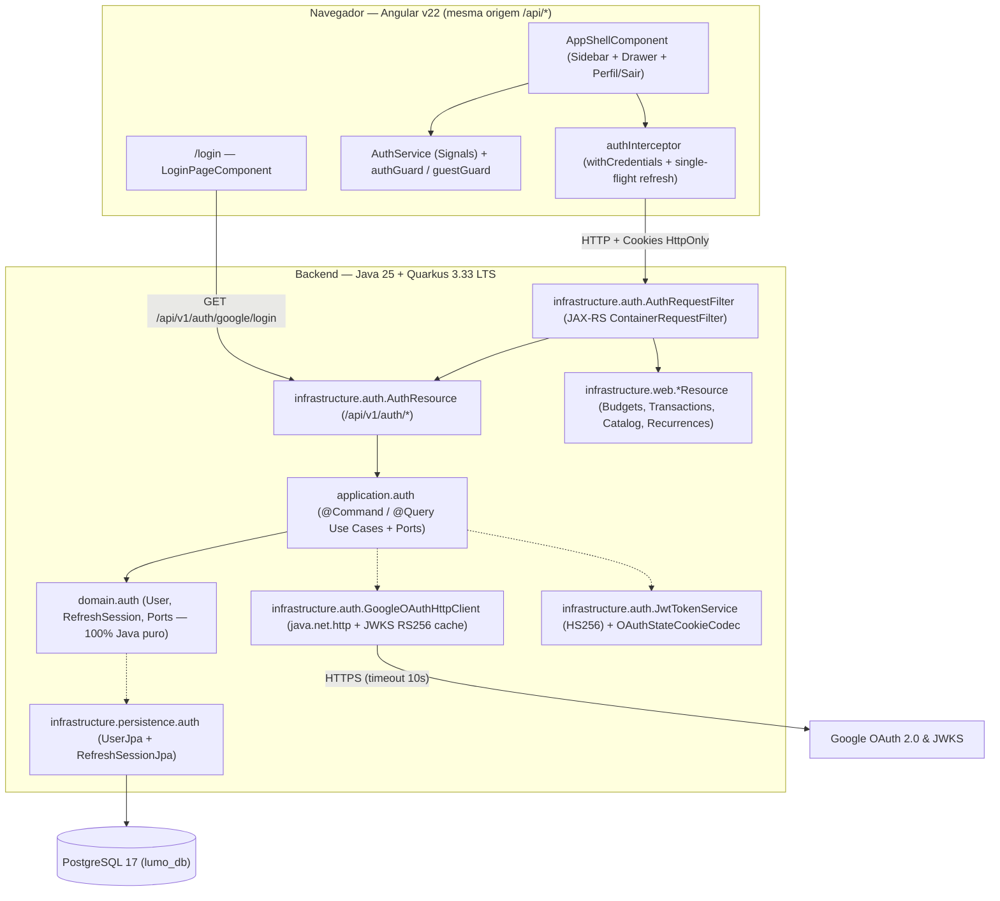
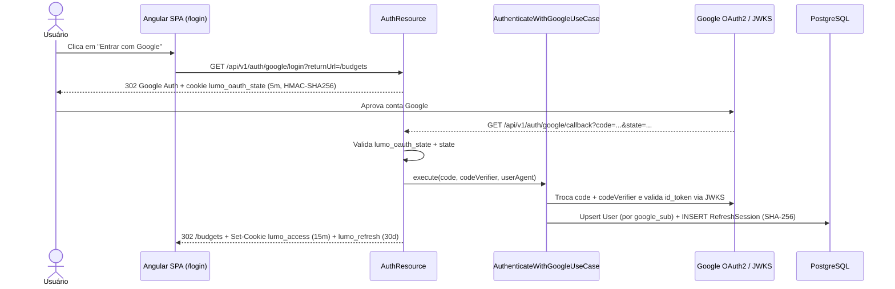
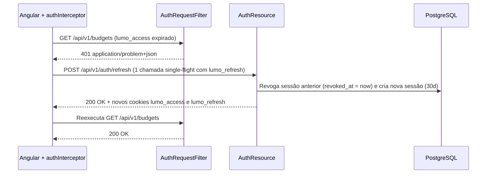
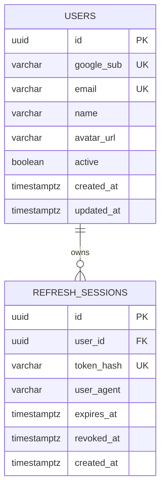

# Google OAuth2 Authentication Design

**Spec**: `.specs/features/04-google-oauth-auth/spec.md`
**Status**: Approved

---

## Architecture Overview

A autenticação do Lumo adota o padrão **Backend-for-Frontend (BFF) OAuth 2.0 Authorization Code + PKCE (S256)** no backend Quarkus 3.33 LTS, tirando proveito do proxy reverso same-origin já configurado em `frontend/nginx.conf` e `frontend/proxy.conf.json` (`/api/` → backend). O Google é usado exclusivamente para provar a identidade do usuário no login; após validação criptográfica do `id_token` (JWKS), o Lumo emite e controla sua **própria sessão** via cookies `HttpOnly` (`lumo_access` JWT HS256 de 15 min + `lumo_refresh` opaco rotativo de 30 dias com hash `SHA-256` em PostgreSQL).



### Fluxo de Login Google OAuth 2.0 + PKCE



### Fluxo de Refresh Rotativo e Proteção de Rotas



---

## Code Reuse Analysis

### Existing Components to Leverage

| Component | Location | How to Use |
| --- | --- | --- |
| Domain Stereotypes (`AggregateRoot`, `Entity`) | `backend/src/main/java/io/github/tiaggofg/lumo/domain/stereotype/` | Estender/implementar em `User` e `RefreshSession` mantendo `domain.auth` 100% Java puro (`AD-003`) |
| `@Command` / `@Query` Stereotypes | `backend/src/main/java/io/github/tiaggofg/lumo/application/stereotype/` | Anotar todos os casos de uso de autenticação (`@Command` transacional para login/refresh/logout; `@Query` read-only para `GetCurrentUserUseCase`) |
| `ClockProducer` | `backend/src/main/java/io/github/tiaggofg/lumo/infrastructure/config/ClockProducer.java` | Injetar `Clock` nos serviços de token e casos de uso para expiração determinística em testes |
| `ProblemDetail` & `ProblemDetailExceptionMapper` | `backend/src/main/java/io/github/tiaggofg/lumo/infrastructure/web/error/` | Reutilizar exatamente o mesmo formato RFC 9457 (`application/problem+json`) para respostas `401`, `403` e `404` |
| `CleanArchitectureArchTest` | `backend/src/test/java/io/github/tiaggofg/lumo/architecture/CleanArchitectureArchTest.java` | Garante automaticamente o isolamento de `domain.auth` e `application.auth` |
| `LumoLogoComponent`, `ZButtonComponent`, `ZTooltipDirective` | `frontend/src/app/shared/ui/` | Construir `LoginPageComponent` e seção de perfil/logout no `AppShellComponent` 100% no design system ZardUI |
| `ThemeService` | `frontend/src/app/core/services/theme.service.ts` | Suportar alternância Light/Dark na tela `/login` usando o mesmo estado persistido |
| `problemDetailInterceptor` | `frontend/src/app/core/interceptors/problem-detail.interceptor.ts` | Suprimir toast em `401` esperados durante checagem inicial (`/api/v1/auth/me`) e refresh transparente |
| `frontend/nginx.conf` & `frontend/proxy.conf.json` | `frontend/nginx.conf`, `frontend/proxy.conf.json` | Já redirecionam `/api/` na mesma origem, viabilizando cookies `HttpOnly; SameSite=Lax` sem ajustes de proxy |

### Integration Points

| System | Integration Method |
| --- | --- |
| Existing REST Resources (`/api/v1/**`) | Protegidos transversalmente por `AuthRequestFilter` (`@Provider`, `@Priority(Priorities.AUTHENTICATION)`), populando `AuthenticatedUserContext` (`@RequestScoped`) sem alterar assinaturas dos endpoints financeiros |
| PostgreSQL (`lumo_db`) | Nova migration Liquibase `003-create-auth-schema.sql` registrada em `db.changelog-master.yaml`, sem tocar nas tabelas financeiras existentes |
| Angular Root Shell (`App` / `AppShellComponent`) | Mover `AppShellComponent` para ser rota-pai autenticada (`canActivate: [authGuard]`) em `app.routes.ts`, deixando `/login` como rota irmão full-screen (`canActivate: [guestGuard]`) e `<router-outlet />` + `<z-toast-viewport />` em `App` |
| Existing Integration & E2E Tests | Criar helper reutilizável de autenticação via `POST /api/v1/auth/dev-login` para `*ResourceIT` (RestAssured) e `frontend/e2e/lumo-mvp.spec.ts` (Playwright) |

---

## Components

### 1. Backend Domain (`domain.auth`)

- **Purpose**: Modelar `User` e `RefreshSession` como entidades de domínio puras com invariantes de ciclo de vida e contratos de repositório.
- **Location**: `backend/src/main/java/io/github/tiaggofg/lumo/domain/auth/`
- **Interfaces**:
  - `User` (`AggregateRoot`): `createFromGoogle(googleSub, email, name, avatarUrl, now)`, `syncGoogleProfile(email, name, avatarUrl, now)`, `isActive()`, `deactivate(now)`, getters imutáveis.
  - `RefreshSession` (`AggregateRoot`): `issue(userId, tokenHash, userAgent, now, expiresAt)`, `isUsableAt(Instant now)`, `revoke(Instant now)`.
  - `UserRepository`: `findById(UUID)`, `findByGoogleSub(String)`, `findByEmail(String)`, `save(User)`.
  - `RefreshSessionRepository`: `findByTokenHash(String)`, `save(RefreshSession)`, `revokeIfActive(UUID sessionId, Instant revokedAt)`.
  - Exceções de domínio: `UnauthorizedException`, `AccountDisabledException`, `EmailNotAllowedException`, `OAuthAuthenticationException`, `DevLoginDisabledException`.
- **Dependencies**: Apenas `java.util.*`, `java.time.*` e `domain.stereotype.*`.
- **Reuses**: `AggregateRoot` e padrão de validação de domínio de `domain.budget` / `domain.catalog`.

### 2. Backend Application (`application.auth`)

- **Purpose**: Orquestrar login Google, login Dev, rotação de refresh token, logout e consulta do usuário atual desacoplados de HTTP e bibliotecas externas.
- **Location**: `backend/src/main/java/io/github/tiaggofg/lumo/application/auth/`
- **Interfaces**:
  - **Ports**:
    - `GoogleOAuthClientPort`: `exchangeCodeAndVerifyIdToken(String code, String codeVerifier, String redirectUri): GoogleUserInfo`
    - `TokenServicePort`: `issueAccessToken(User user): String`, `verifyAccessToken(String token): Optional<AccessTokenClaims>`, `generateOpaqueToken(): String`, `sha256Hex(String rawToken): String`
    - `AuthConfigPort`: `isGoogleEnabled()`, `isDevLoginEnabled()`, `isEmailAllowed(String email)`, `accessTokenTtl()`, `refreshTokenTtl()`
  - **Use Cases**:
    - `AuthenticateWithGoogleUseCase` (`@Command`): troca código via port, valida `emailVerified`, verifica `isEmailAllowed`, faz upsert de `User` por `googleSub`, bloqueia se `!user.isActive()`, emite `RefreshSession` + `AuthSessionResult`.
    - `AuthenticateDevUserUseCase` (`@Command`): valida `isDevLoginEnabled()`, faz upsert de `dev@lumo.local` (`google_sub = "dev-local-user"`), emite `AuthSessionResult`.
    - `RefreshSessionUseCase` (`@Command`): calcula `sha256Hex`, busca sessão, executa `revokeIfActive` atomicamente, valida `expiresAt > now` e `user.isActive()`, cria nova `RefreshSession` e retorna novo `AuthSessionResult`.
    - `LogoutUseCase` (`@Command`): se refresh token presente, revoga a sessão correspondente por hash (idempotente se inexistente/já revogada).
    - `GetCurrentUserUseCase` (`@Query`): busca `User` ativo por ID e retorna `UserSummary`.
- **Dependencies**: `domain.auth.*`, `application.stereotype.*`, `Clock`.
- **Reuses**: `@Command`, `@Query`, padrão de records de entrada/saída de `application.budget`.

### 3. Backend Persistence (`infrastructure.persistence.auth`)

- **Purpose**: Persistir `User` e `RefreshSession` no PostgreSQL via Hibernate ORM + Liquibase.
- **Location**: `backend/src/main/java/io/github/tiaggofg/lumo/infrastructure/persistence/auth/` e `backend/src/main/resources/db/changelog/003-create-auth-schema.sql`
- **Interfaces**:
  - `UserJpaEntity`, `UserJpaRepositoryAdapter` (implementa `UserRepository`)
  - `RefreshSessionJpaEntity`, `RefreshSessionJpaRepositoryAdapter` (implementa `RefreshSessionRepository`, com `UPDATE refresh_sessions SET revoked_at = :now WHERE id = :id AND revoked_at IS NULL` retornando `boolean` para garantia atômica contra concorrência).
- **Dependencies**: `jakarta.persistence.*`, `EntityManager`.
- **Reuses**: Padrão de mapeamento JPA dos adapters em `infrastructure.persistence.catalog`.

### 4. Backend Auth Infrastructure (`infrastructure.auth`)

- **Purpose**: Implementar cliente HTTP + verificador JWKS RS256 do Google, assinatura JWT HS256 própria, cookies `HttpOnly`, filtro de proteção `/api/v1/**` e endpoints REST `/api/v1/auth/*`.
- **Location**: `backend/src/main/java/io/github/tiaggofg/lumo/infrastructure/auth/`
- **Interfaces**:
  - `AuthConfig`: `@ConfigMapping(prefix = "lumo.auth")` + `AuthStartupValidator` (`@Startup`) que aborta a inicialização em `%prod` se `lumo.auth.jwt-secret` estiver vazio ou `< 32` caracteres.
  - `JwtTokenService` (implementa `TokenServicePort`): assina e valida JWT `HS256` (`javax.crypto.Mac` + `java.util.Base64` + Jackson — zero dependência externa pesada!), gera tokens opacos de 256 bits (`SecureRandom`) e `SHA-256` hex.
  - `OAuthStateCookieCodec`: serializa `{ state, codeVerifier, returnUrl, exp }` assinado com HMAC-SHA256 usando `jwt-secret` para o cookie `lumo_oauth_state` (5 min), com sanitização estrita de `returnUrl` (`startsWith("/") && !startsWith("//") && !contains("\\")`).
  - `GoogleOAuthHttpClient` (implementa `GoogleOAuthClientPort`): usa `java.net.http.HttpClient` (timeout 10s) para `POST https://oauth2.googleapis.com/token`, busca JWKS em `https://www.googleapis.com/oauth2/v3/certs` com cache em memória + reload on unknown `kid`, valida assinatura `RS256` via `java.security.Signature("SHA256withRSA")` + `iss` (`https://accounts.google.com` ou `accounts.google.com`) + `aud` + `exp` + `email_verified = true`.
  - `AuthCookieHelper`: cria e limpa `NewCookie` (`lumo_access`, `lumo_refresh`, `lumo_oauth_state`) com `HttpOnly=true`, `SameSite=Lax` e `Secure` via `lumo.auth.cookie-secure`.
  - `AuthRequestFilter` (`@Provider`, `@Priority(Priorities.AUTHENTICATION)`): libera explicitamente `/api/v1/auth/providers`, `/api/v1/auth/google/login`, `/api/v1/auth/google/callback`, `/api/v1/auth/refresh`, `/api/v1/auth/logout`, `/api/v1/auth/dev-login` e rotas fora de `/api/v1/`; para todas as demais rotas `/api/v1/**`, exige cookie `lumo_access` válido e usuário ativo, ou aborta com `401 application/problem+json`.
  - `AuthResource` (`@Path("/api/v1/auth")`): expõe `GET /providers`, `GET /google/login`, `GET /google/callback`, `POST /dev-login`, `POST /refresh`, `POST /logout`, `GET /me`.
- **Dependencies**: JDK 25 (`java.net.http`, `java.security`, `javax.crypto`), Quarkus REST / Jackson, `ProblemDetail`.
- **Reuses**: `ProblemDetail`, `ProblemDetailExceptionMapper`, `ClockProducer`.

### 5. Frontend Auth Core & UI (`frontend/src/app/core/auth/` & `features/auth/`)

- **Purpose**: Gerenciar estado reativo de sessão, proteger rotas, renovar access token silenciosamente, renderizar `/login` e exibir usuário + logout no shell.
- **Location**:
  - `frontend/src/app/core/auth/auth.service.ts`
  - `frontend/src/app/core/auth/auth.guard.ts` (`authGuard`, `guestGuard`, `sanitizeReturnUrl`)
  - `frontend/src/app/core/auth/auth.interceptor.ts`
  - `frontend/src/app/features/auth/login-page.component.ts`
  - `frontend/src/app/core/layout/app-shell.component.ts` (modify)
  - `frontend/src/app/app.ts` & `frontend/src/app/app.routes.ts` & `frontend/src/app/app.config.ts` (modify)
- **Interfaces**:
  - `AuthService`:
    - Signals: `user = signal<AuthUser | null>(null)`, `status = signal<'loading' | 'authenticated' | 'unauthenticated'>('loading')`, `isAuthenticated = computed(...)`.
    - Methods: `ensureSessionLoaded(): Promise<boolean>`, `loadProviders(): Promise<AuthProviders>`, `startGoogleLogin(returnUrl?: string | null): void`, `loginAsDev(): Promise<AuthUser>`, `refreshSession(): Observable<AuthUser>`, `logout(): Promise<void>`, `clearLocalState(): void`.
  - `authInterceptor`: anexa `withCredentials: true` em `/api/`, intercepta `401` (exceto `/api/v1/auth/refresh`, `/api/v1/auth/logout`, `/api/v1/auth/dev-login`, `/api/v1/auth/providers`), compartilha uma única chamada `refreshSession()` em voo (`shareReplay(1)`), refaz a requisição original ou redireciona para `/login`.
  - `LoginPageComponent`: tela dedicada full-screen com `<app-lumo-logo>`, botão Light/Dark, card ZardUI, banner de erro PT-BR para `?error=...`, botão **"Entrar com Google"** (`data-testid="google-login-button"`) e botão condicional **"Entrar como Dev"** (`data-testid="dev-login-button"`).
- **Dependencies**: `@angular/common/http`, `@angular/router`, `rxjs`, `ThemeService`, `ZButtonComponent`, `LumoLogoComponent`, `ZTooltipDirective`.
- **Reuses**: Design system ZardUI (`AD-010`), paleta Royal Indigo/Safira (`AD-009`), `AppShellComponent`.

---

## Data Models

### Liquibase Migration (`003-create-auth-schema.sql`)

```sql
--liquibase formatted sql

--changeset lumo:003-create-auth-schema
CREATE TABLE users (
    id          UUID         PRIMARY KEY,
    google_sub  VARCHAR(255) NOT NULL,
    email       VARCHAR(255) NOT NULL,
    name        VARCHAR(200) NOT NULL,
    avatar_url  VARCHAR(1024),
    active      BOOLEAN      NOT NULL DEFAULT TRUE,
    created_at  TIMESTAMPTZ  NOT NULL,
    updated_at  TIMESTAMPTZ  NOT NULL,
    CONSTRAINT uq_users_google_sub UNIQUE (google_sub),
    CONSTRAINT uq_users_email      UNIQUE (email)
);

CREATE TABLE refresh_sessions (
    id          UUID         PRIMARY KEY,
    user_id     UUID         NOT NULL REFERENCES users (id) ON DELETE CASCADE,
    token_hash  VARCHAR(64)  NOT NULL,
    user_agent  VARCHAR(512),
    expires_at  TIMESTAMPTZ  NOT NULL,
    revoked_at  TIMESTAMPTZ,
    created_at  TIMESTAMPTZ  NOT NULL,
    CONSTRAINT uq_refresh_sessions_token_hash UNIQUE (token_hash)
);

CREATE INDEX idx_refresh_sessions_user_id ON refresh_sessions (user_id);
CREATE INDEX idx_refresh_sessions_expires_at ON refresh_sessions (expires_at);
```



### Frontend Models (`frontend/src/app/core/auth/auth.models.ts`)

```typescript
export interface AuthUser {
  id: string;
  email: string;
  name: string;
  avatarUrl: string | null;
}

export interface AuthProviders {
  googleEnabled: boolean;
  devLoginEnabled: boolean;
}

export type AuthStatus = 'loading' | 'authenticated' | 'unauthenticated';
```

---

## Error Handling Strategy

| Error Scenario | Handling | User Impact |
| --- | --- | --- |
| Requisição sem `lumo_access` ou com JWT expirado/inválido em `/api/v1/**` | `AuthRequestFilter` responde `401 Unauthorized` (`application/problem+json`) | No Angular, `authInterceptor` tenta 1 refresh silencioso; se falhar, redireciona para `/login?returnUrl=...` sem toast intrusivo |
| Google callback com `error=access_denied` | `AuthResource` limpa `lumo_oauth_state` e redireciona `302 /login?error=access_denied` | `/login` exibe alerta: *"Acesso cancelado na conta Google. Tente novamente quando quiser."* |
| Cookie `lumo_oauth_state` ausente, expirado ou `state` divergente | `AuthResource` limpa cookie e redireciona `302 /login?error=invalid_state` | `/login` exibe alerta: *"Sessão de login expirada ou inválida. Inicie o acesso novamente."* |
| `id_token` inválido, `email_verified != true` ou erro de troca no Google | `AuthResource` registra log `WARN` (sem tokens/segredos) e redireciona `302 /login?error=oauth_failed` | `/login` exibe alerta: *"Não foi possível validar sua conta Google. Tente novamente."* |
| Timeout/falha de rede no Google ou credenciais OAuth ausentes | Redireciona `302 /login?error=provider_unavailable` | `/login` exibe alerta: *"Serviço de login do Google temporariamente indisponível."* |
| E-mail fora de `LUMO_ALLOWED_EMAILS` (quando configurada) | `EmailNotAllowedException` → `302 /login?error=email_not_allowed` | `/login` exibe alerta: *"Este e-mail não está autorizado a acessar este ambiente do Lumo."* |
| Usuário marcado com `active = false` | `AccountDisabledException` → `302 /login?error=account_disabled` (no callback) ou `401/403` no refresh | `/login` exibe alerta: *"Sua conta está desativada."* |
| `POST /api/v1/auth/dev-login` chamado em `%prod` (`dev-login.enabled=false`) | `DevLoginDisabledException` → `404 Not Found` (`application/problem+json`) | Endpoint invisível/inexistente em produção; botão não renderizado |
| `POST /api/v1/auth/refresh` com token revogado/reusado/expirado | Limpa `lumo_access` e `lumo_refresh` (`Max-Age=0`) e retorna `401` (`application/problem+json`) | Angular limpa estado e redireciona para `/login` |

---

## Risks & Concerns

| Concern | Location (file:line) | Impact | Mitigation |
| --- | --- | --- | --- |
| Testes de integração existentes (`*ResourceIT`) chamam `/api/v1/**` sem autenticação | `backend/src/test/java/io/github/tiaggofg/lumo/infrastructure/web/**/*ResourceIT.java` | Todos os `*ResourceIT` passarão a receber `401` após ativar `AuthRequestFilter` | Criar utilitário `AuthTestHelper` (usando `POST /api/v1/auth/dev-login` no perfil `%test`) e atualizar os 5 `*ResourceIT` na mesma task da ativação do filtro (`T6`), garantindo gate verde contínuo |
| Suíte E2E existente navega direto para `/dashboard`, `/budgets`, `/recurrences`, `/catalog` | `frontend/e2e/lumo-mvp.spec.ts` | Testes existentes serão redirecionados para `/login` após adicionar `authGuard` | Atualizar `lumo-mvp.spec.ts` com helper de login via `POST /api/v1/auth/dev-login` (ou botão `"Entrar como Dev"`) no `beforeEach` na task de E2E (`T12`) e adicionar suíte dedicada de autenticação |
| `problemDetailInterceptor` dispara toast para todo `HttpErrorResponse`, inclusive `401` de `/api/v1/auth/me` no boot | `frontend/src/app/core/interceptors/problem-detail.interceptor.ts:12` | Visitante anônimo veria toast vermelho de erro ao abrir `/login` | Ordenar `[authInterceptor, problemDetailInterceptor]` em `app.config.ts` e ignorar toast para `401` de `/api/v1/auth/me` e `/api/v1/auth/refresh` em `problemDetailInterceptor` |
| `App` renderiza `<app-shell />` diretamente na raiz | `frontend/src/app/app.ts:8` | Rota `/login` apareceria dentro da sidebar desktop/mobile se `AppShellComponent` ficar no root | Alterar `App` para renderizar `<z-toast-viewport />`, `<z-confirm-dialog />` e `<router-outlet />`, movendo `AppShellComponent` para rota wrapper autenticada em `app.routes.ts` |
| Queda/rotação de chaves públicas JWKS do Google | `infrastructure/auth/GoogleOAuthHttpClient.java` | Falha na validação do `id_token` quando o Google rotaciona chaves | Cachear JWKS por `Cache-Control max-age` (fallback 1h) e forçar 1 refresh imediato do cache sempre que o `kid` do cabeçalho do `id_token` não for encontrado |
| Startup acidental em produção com segredo JWT padrão ou fraco | `backend/src/main/resources/application.properties` | Risco crítico de forja de JWT em produção | Configurar `lumo.auth.jwt-secret` sem valor default em `%prod` e validar `>= 32` chars em `AuthStartupValidator` (`@Startup`), abortando o boot se inválido |

---

## Tech Decisions (only non-obvious ones)

| Decision | Choice | Rationale |
| --- | --- | --- |
| Assinatura JWT própria sem nova biblioteca pesada | `HS256` implementado com `javax.crypto.Mac` (`HmacSHA256`) + Jackson + Base64URL da JDK 25 | Zero dependências novas no `pom.xml`, 100% compatível com Java 25/Quarkus 3.33 e fácil de auditar e testar |
| Validação criptográfica do `id_token` do Google | `java.net.http.HttpClient` + `java.security.Signature("SHA256withRSA")` com chaves RSA (`n`, `e`) do JWKS oficial do Google | Evita trazer o SDK completo do Google (`google-api-client`), mantém footprint enxuto (`AD-002`) e garante verificação criptográfica real |
| Filtro de autenticação transversal | JAX-RS `ContainerRequestFilter` (`@Priority(Priorities.AUTHENTICATION)`) em `infrastructure.auth` | Integra diretamente com o `ProblemDetail` RFC 9457 existente sem introduzir complexidade do `quarkus-oidc` session manager acoplado ao TTL de 1h do Google |
| `LUMO_ALLOWED_EMAILS` opcional | Vazia por padrão (confia nos *Test users* do Google); se preenchida, valida case-insensitive no `AuthenticateWithGoogleUseCase` | Zero atrito inicial conforme pedido do usuário, com defesa em profundidade pronta contra publicação acidental do app no Google Cloud |
| Registro como `AD-011` em `.specs/STATE.md` | Sim — decisão duradoura de segurança e sessões da Fase 2 | Evolui `AD-007` definindo o padrão oficial de autenticação, cookies `HttpOnly` e modo `%dev` para futuras features (como `Household`) |
