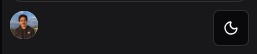

# Sidebar Profile Footer & Account Popover Specification

**Status**: Approved
**Approved**: 2026-11-27 - user: "aprovado"

## Problem Statement

O rodapé atual do menu lateral (`AppShellComponent`) empilha o botão de alternância de tema, o bloco textual de nome/e-mail e um botão dedicado "Sair", consumindo espaço vertical desnecessário e destoando do visual compacto desejado. Além disso, no mobile, o botão de tema fica duplicado na barra superior em vez de integrado ao rodapé do menu. Esta especificação reorganiza o rodapé do menu para exibir a foto de perfil e o botão de tema na mesma linha, movendo os detalhes da conta e a ação de saída (`Sair`) para um popover flutuante ancorado à foto de perfil.

## Goals

- [x] Compactar o rodapé do menu lateral (desktop expandido e drawer mobile) em uma única linha com a foto de perfil à esquerda e o botão de troca de tema à direita, seguindo `captures/sidebar-footer.png`.
- [x] Exibir o popover flutuante de conta ao clicar na foto de perfil, seguindo o layout de `captures/profile-popover.png` com os ajustes aprovados em `AD-012` (iniciais em badge quadrado arredondado, nome, divisor, e-mail e ação `Sair`).
- [x] Garantir comportamento responsivo consistente na sidebar desktop recolhida (`w-20`, ícones empilhados verticalmente) e no mobile (rodapé unificado no drawer e remoção do botão de tema duplicado da barra superior).

## Out of Scope

Explicitly excluded. Documented to prevent scope creep.

| Feature | Reason |
| --- | --- |
| Item "Meu perfil" (`My profile`) e tela de edição de perfil | Solicitado explicitamente pelo usuário para não aparecer nesta entrega (`AD-012`). |
| Criação ou troca de equipes/workspaces (`+ Create team` e ícone `✓`) | O Lumo opera em workspace único nesta fase; item borrado no print e excluído em `AD-012`. |
| Alterações no backend ou nos endpoints de autenticação (`/api/v1/auth/*`) | O fluxo de logout e os dados de `AuthUser` (`name`, `email`, `avatarUrl`) já existem no frontend e backend. |
| Upload ou alteração de foto de perfil | A foto continua vindo do campo `avatarUrl` da sessão autenticada (com fallback para iniciais). |

---

## Assumptions & Open Questions

Every ambiguity is resolved or recorded here - nothing is left silently unclear.

| Assumption / decision | Chosen default | Rationale | Confirmed? |
| --- | --- | --- | --- |
| Layout do rodapé na sidebar desktop recolhida (`w-20`) | Empilhar verticalmente centralizados (foto de perfil e botão de tema) quando `sidebarCollapsed()` for `true`; manter lado a lado quando expandida | Evita aperto horizontal na largura de `80px` preservando área clicável confortável | y |
| Comportamento no menu mobile | Aplicar o mesmo rodapé (foto + tema na mesma linha e popover de conta) no drawer mobile e remover o botão de tema da barra superior mobile | Mantém paridade entre desktop e mobile e elimina controle duplicado na barra superior | y |
| Textos e itens do popover em relação à captura | Rótulo `Sair` em português; topo com quadrado arredondado de inicial + nome do usuário (sem `+ Create team`, sem `My profile` e sem `✓`) | Alinhado ao idioma PT-BR do Lumo e às funcionalidades ativas (`AD-012`) | y |
| Tipo de overlay ao clicar na foto de perfil | Popover flutuante ancorado próximo à foto de perfil (fecha ao clicar fora, clicar novamente na foto ou pressionar `Escape`) | Corresponde diretamente ao comportamento visual do print anexado | y |
| Fallback quando `avatarUrl` for `null` ou falhar ao carregar | Exibir círculo com as iniciais do usuário (`userInitials()`) no botão do rodapé e quadrado arredondado com a primeira inicial no topo do popover | Comportamento já estabelecido em `AppShellComponent` para usuários sem foto (ex.: Dev login) | y |

**Open questions:** none - all resolved or logged above (required before the spec is confirmed).

---

## User Stories

### P1: Rodapé compacto do menu com foto de perfil e alternância de tema ⭐ MVP

**User Story**: Como usuário autenticado do Lumo, quero ver minha foto de perfil e o botão de trocar o tema na mesma linha no rodapé do menu para manter a barra lateral limpa e objetiva.

**Why P1**: É a mudança visual principal solicitada no rodapé do menu desktop e mobile.

**Acceptance Criteria**:

1. (`SHELL-01`) WHILE a sidebar desktop estiver expandida (`data-collapsed="false"`), the system SHALL exibir o rodapé do menu com a foto de perfil circular à esquerda e o botão quadrado com borda de alternância de tema à direita na mesma linha conforme `.specs/features/05-sidebar-profile-footer/captures/sidebar-footer.png`, sem exibir nome, e-mail ou botão "Sair" inline no rodapé.
2. (`SHELL-02`) WHILE a sidebar desktop estiver recolhida (`data-collapsed="true"`), the system SHALL empilhar verticalmente e centralizar o botão da foto de perfil e o botão de alternância de tema no rodapé da sidebar, exibindo tooltips de acessibilidade ao passar o cursor.
3. (`SHELL-03`) WHEN o usuário clicar no botão de alternância de tema no rodapé do menu (desktop ou drawer mobile) THEN the system SHALL alternar imediatamente entre modo escuro e modo claro via `ThemeService.toggle()`, atualizando o ícone (lua para modo escuro disponível, sol para modo claro disponível) e o `aria-label`.
4. (`SHELL-04`) WHILE o drawer de navegação mobile (`data-testid="mobile-drawer"`) estiver aberto, the system SHALL exibir no rodapé do drawer a mesma linha com a foto de perfil à esquerda e o botão de alternância de tema à direita, e the system SHALL NOT exibir botão de alternância de tema na barra superior mobile (`header`).

**Independent Test**: Abrir a aplicação autenticada em desktop (expandido e recolhido) e em viewport mobile (`390x844`), verificar o rodapé com avatar + botão de tema na mesma linha, alternar o tema e confirmar ausência do botão de tema na barra superior mobile.

---

### P1: Popover de perfil ancorado com ação de logout ⭐ MVP

**User Story**: Como usuário autenticado do Lumo, quero clicar na minha foto de perfil no rodapé do menu para abrir um popover com minha identificação e a opção de sair da conta.

**Why P1**: Sem o popover de perfil o usuário não consegue visualizar seu e-mail nem realizar logout após a compactação do rodapé.

**Acceptance Criteria**:

1. (`POPOVER-01`) WHEN o usuário clicar no botão da foto de perfil no rodapé do menu (desktop expandido, desktop recolhido ou drawer mobile) THEN the system SHALL abrir um popover flutuante ancorado próximo à foto de perfil com o layout de `.specs/features/05-sidebar-profile-footer/captures/profile-popover.png` (aplicando as diferenças aprovadas em `AD-012`): cabeçalho com badge quadrado arredondado contendo a inicial do usuário e o nome do usuário (`currentUser.name`), linha divisória horizontal, e-mail do usuário (`currentUser.email`) e botão de ação `Sair` com ícone de saída.
2. (`POPOVER-02`) WHILE o popover de perfil estiver aberto, the system SHALL manter `aria-expanded="true"` no botão da foto de perfil e renderizar o popover acima do conteúdo principal (`z-index` superior ao `<main>` e sem corte por `overflow` da sidebar).
3. (`POPOVER-03`) WHEN o usuário clicar fora do popover de perfil, clicar novamente no botão da foto de perfil ou pressionar a tecla `Escape` THEN the system SHALL fechar o popover de perfil e restaurar `aria-expanded="false"`.
4. (`POPOVER-04`) WHEN o usuário clicar no botão `Sair` dentro do popover de perfil THEN the system SHALL fechar o popover (e o drawer mobile, se aberto) e invocar `AuthService.logout()`, encerrando a sessão e redirecionando para `/login`.

**Independent Test**: Clicar na foto de perfil no rodapé (desktop expandido, desktop recolhido e mobile drawer), validar exibição de inicial, nome, e-mail e botão `Sair`, testar fechamento por clique externo e `Escape`, e confirmar que clicar em `Sair` redireciona para `/login`.

---

## Edge Cases

- (`EDGE-01`) IF `currentUser.avatarUrl` for `null` ou vazio THEN the system SHALL renderizar o avatar circular no rodapé com as iniciais calculadas (`userInitials()`) mantendo as mesmas dimensões e clicabilidade do botão de perfil.
- (`EDGE-02`) IF o usuário alternar o estado de recolhimento da sidebar (`toggleSidebar()`) ou fechar o drawer mobile WHILE o popover de perfil estiver aberto THEN the system SHALL fechar o popover de perfil para evitar posicionamento desalinhado.
- (`EDGE-03`) IF o nome ou o e-mail do usuário ultrapassar a largura máxima do popover THEN the system SHALL truncar o texto com reticências (`truncate`) sem quebrar o layout nem gerar overflow horizontal.
- (`EDGE-04`) IF o botão de alternância de tema for acionado WHILE o popover de perfil estiver aberto THEN the system SHALL aplicar o novo tema imediatamente sem sobrepor ou corromper o contraste do popover nos modos claro e escuro.

---

## Requirement Traceability

| Requirement ID | Story | Phase | Status |
| --- | --- | --- | --- |
| SHELL-01 | P1: Rodapé compacto do menu | In Tasks | Pending |
| SHELL-02 | P1: Rodapé compacto do menu | In Tasks | Pending |
| SHELL-03 | P1: Rodapé compacto do menu | In Tasks | Pending |
| SHELL-04 | P1: Rodapé compacto do menu | In Tasks | Pending |
| POPOVER-01 | P1: Popover de perfil ancorado | In Tasks | Pending |
| POPOVER-02 | P1: Popover de perfil ancorado | In Tasks | Pending |
| POPOVER-03 | P1: Popover de perfil ancorado | In Tasks | Pending |
| POPOVER-04 | P1: Popover de perfil ancorado | In Tasks | Pending |
| EDGE-01 | Edge Cases | In Tasks | Pending |
| EDGE-02 | Edge Cases | In Tasks | Pending |
| EDGE-03 | Edge Cases | In Tasks | Pending |
| EDGE-04 | Edge Cases | In Tasks | Pending |

**Coverage:** 12 total, 12 mapped to tasks, 0 unmapped.

---

## Differences from the source

| Source shows | Product shows | Confirmed |
| --- | --- | --- |
| `+ Create team` no bloco superior de `profile-popover.png` | Omitido (não renderizado) | y - AD-012 |
| Ícone `✓` ao lado do nome em `profile-popover.png` | Omitido (não renderizado) | y - AD-012 |
| Item `My profile` em `profile-popover.png` | Omitido (não renderizado) | y - AD-012 |
| Rótulo `Log out` em inglês em `profile-popover.png` | Rótulo `Sair` em português | y - AD-012 |

## Sources

- Solicitação do usuário nesta sessão - definição do rodapé compacto, popover de perfil e exclusão de "Meu perfil".
-  - binding - Layout horizontal do rodapé da sidebar expandida com foto de perfil circular à esquerda e botão quadrado com borda para troca de tema à direita.
-  - binding - Layout visual do card/popover flutuante com cabeçalho de identificação (quadrado arredondado com inicial + nome), divisor horizontal, e-mail e ação de logout (com diferenças aprovadas em `AD-012`).

---

## Success Criteria

- [x] Rodapé da sidebar desktop expandida e do drawer mobile exibe foto de perfil e botão de tema na mesma linha conforme `captures/sidebar-footer.png`.
- [x] Sidebar desktop recolhida empilha foto de perfil e botão de tema verticalmente centralizados sem cortes nem sobreposição.
- [x] Clique na foto de perfil abre popover ancorado conforme `captures/profile-popover.png` (com ajustes de `AD-012`), fecha com clique fora / `Escape` / segundo clique, e executa logout ao clicar em `Sair`.
- [x] Testes unitários (Vitest) e E2E (Playwright desktop + mobile) validam todos os fluxos sem erros de console ou regressões.
