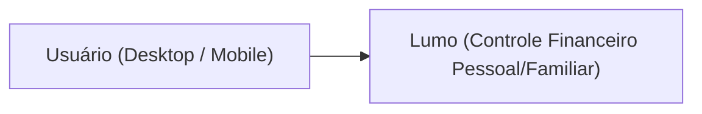
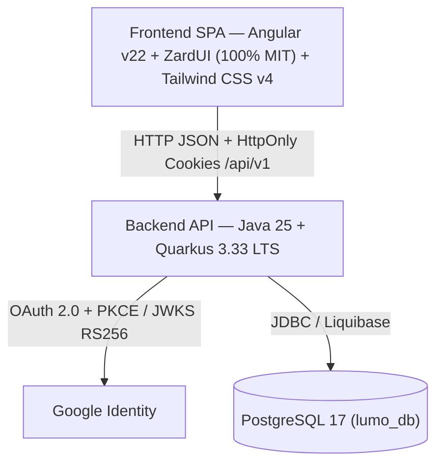
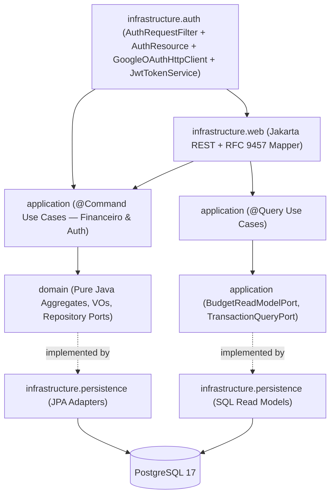
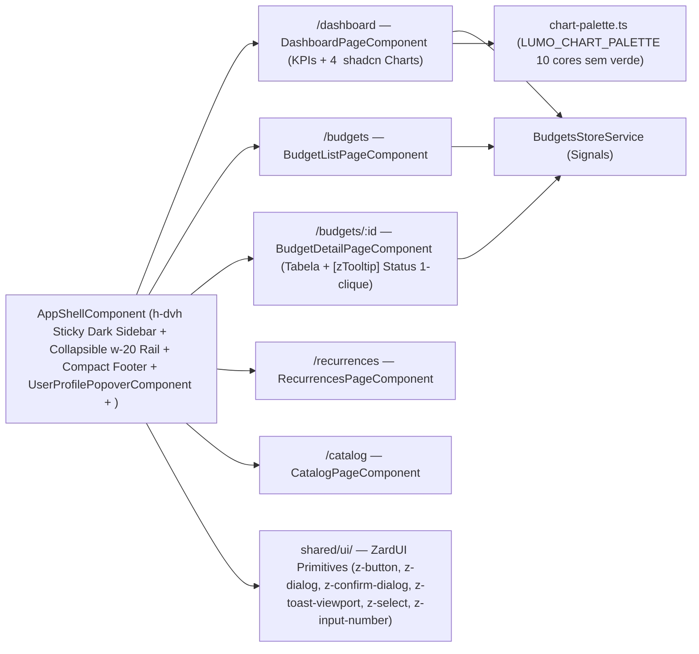

# Arquitetura e Diagramas C4

## 1. Diagrama de Contexto (C1)

## 2. Diagrama de Containers (C2)

## 3. Componentes e Camadas (C3)

### Fronteiras Verificadas por ArchUnit (`CleanArchitectureArchTest`)
- `domain..` não acessa `io.quarkus..`, `jakarta..`, `org.hibernate..`, `com.fasterxml..`, `application..` nem `infrastructure..`.
- `application..` não acessa `infrastructure..`, `jakarta.persistence..` nem `jakarta.ws.rs..`.
- `@Command` e `@Query` só podem ser usados em `..application..`.
- Nenhum `AggregateRoot` em `..domain..` pode possuir anotações JPA (`@Entity`, `@Table`).

## 4. Arquitetura do Frontend (`AD-009`, `AD-010`, `AD-012`)

