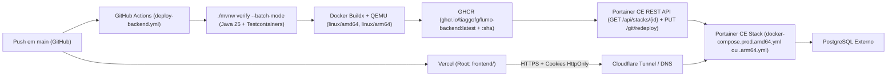

# Deploy e CI/CD

Este documento descreve a execução local, a arquitetura de produção (**Vercel + Portainer CE + PostgreSQL externo + Cloudflare Tunnel**) e o pipeline de entrega contínua do **Lumo**.

---

## Ambiente Local

### Stack Completa via Docker Compose
```bash
docker compose up -d --build
```
Sobe PostgreSQL 17 (`5432`), Backend Quarkus (`8080`) e Frontend Angular/Nginx (`4200`, configurável via `LUMO_FRONTEND_PORT`).

Para apontar o container `backend` para um PostgreSQL externo (ex.: Neon, Supabase, Aiven) via `.env` na raiz, defina `DB_URL`, `DB_USERNAME` e `DB_PASSWORD` e suba sem o serviço local de banco:
```bash
docker compose up -d --no-deps backend frontend
```

### Modo Desenvolvimento (Live Reload)
1. **Banco de Dados**:
   ```bash
   docker compose up -d postgres
   ```
   Sobe PostgreSQL 17 (`lumo_db`, porta `5432`).
2. **Backend (Quarkus 3.33 LTS + Java 25)**:
   ```bash
   cd backend && ./mvnw quarkus:dev
   ```
3. **Frontend (Angular v22 + Node 24.15+)**:
   ```bash
   cd frontend && npm install && npm start
   ```
   Sem `BACKEND_URL` definido, `frontend/src/environments/environment.ts` usa `apiUrl: ''` e as chamadas `/api/*` continuam passando pelo `proxy.conf.json` local (ou pelo `nginx.conf` no Docker Compose local).

---

## Arquitetura de Produção (Vercel + Portainer CE)

Em produção, o Lumo opera com comunicação direta cross-origin entre o frontend na **Vercel** e o backend Quarkus em um **Portainer CE** (VPS Linux **AMD64** ou **ARM64**), conectado a um **PostgreSQL externo** e exposto via **Cloudflare Tunnel / DNS**:



---

## 1. Configuração do Frontend na Vercel

1. Importe o repositório `lumo-app` na Vercel.
2. Em **Project Settings → General → Root Directory**, configure:
   - `frontend`
3. O roteamento SPA já está configurado em `frontend/vercel.json` (rewrite `/(.*)` → `/index.html`).
4. O build padrão (`npm run build`) executa `node scripts/set-env.mjs && ng build`, gerando `frontend/src/environments/environment.ts` com `apiUrl` normalizado (sem barras finais).
5. Em **Project Settings → Environment Variables**, adicione:

| Variável | Obrigatória | Exemplo | Descrição |
| --- | --- | --- | --- |
| `BACKEND_URL` | Sim | `https://api.lumo.seudominio.com` | URL pública HTTPS do backend (fallback para `API_URL` se `BACKEND_URL` não estiver definida). |

> [!NOTE]
> Todas as requisições `/api/*` do Angular passam pelo `apiUrlInterceptor` com `withCredentials: true`, e o login Google OAuth (`AuthService.buildGoogleLoginUrl`) redireciona diretamente para `${BACKEND_URL}/api/v1/auth/google/login`.

---

## 2. Configuração do Backend no Portainer CE (Git Stack)

O repositório oferece dois arquivos Compose dedicados de produção (ambos com serviço único `backend`, imagem multi-arch `ghcr.io/tiaggofg/lumo-backend:latest`, usuário não-root `appuser`, `extra_hosts: host.docker.internal:host-gateway` e healthcheck em `/q/health/ready`):

| Arquivo | Arquitetura | Uso Recomendado | `JAVA_OPTS_APPEND` Padrão |
| --- | --- | --- | --- |
| `docker-compose.prod.amd64.yml` | `linux/amd64` | VPS x86_64 enxuta (ex.: Oracle Cloud `E2.1.Micro` com 1 GB RAM) | `-Dquarkus.http.host=0.0.0.0 -Xms64m -Xmx220m` |
| `docker-compose.prod.arm64.yml` | `linux/arm64` | VPS ARM64 (ex.: Oracle Cloud `A1.Flex`) | `-Dquarkus.http.host=0.0.0.0` |

### Criando a Stack no Portainer CE
1. Acesse **Stacks → Add stack → Repository**.
2. Configure:
   - **Repository URL**: `https://github.com/tiaggofg/lumo-app`
   - **Repository reference**: `refs/heads/main`
   - **Compose path**: `docker-compose.prod.amd64.yml` (para host AMD64) **ou** `docker-compose.prod.arm64.yml` (para host ARM64).
3. Cadastre as **Environment variables** da stack:

| Variável | Obrigatória | Padrão | Descrição |
| --- | --- | --- | --- |
| `DB_URL` | Sim | — | JDBC URL do PostgreSQL externo (ex.: `jdbc:postgresql://host:5432/lumo_db?sslmode=require` ou `jdbc:postgresql://host.docker.internal:5432/lumo_db`) |
| `DB_USERNAME` | Sim | — | Usuário do PostgreSQL |
| `DB_PASSWORD` | Sim | — | Senha do PostgreSQL |
| `CORS_ALLOWED_ORIGINS` | Sim | — | Origem(ns) do frontend na Vercel separadas por vírgula (ex.: `https://lumo.seudominio.com`) |
| `LUMO_FRONTEND_URL` | Sim | — | URL pública do frontend para redirecionamento pós-OAuth (ex.: `https://lumo.seudominio.com`) |
| `LUMO_AUTH_JWT_SECRET` | Sim | — | Segredo HMAC-SHA256 com **mínimo de 32 caracteres** (validado no startup em `%prod`) |
| `GOOGLE_OAUTH_CLIENT_ID` | Sim | — | Client ID OAuth 2.0 Web Application do Google Cloud Console |
| `GOOGLE_OAUTH_CLIENT_SECRET` | Sim | — | Client Secret OAuth 2.0 do Google Cloud Console |
| `GOOGLE_OAUTH_REDIRECT_URI` | Sim | — | URI pública de callback no backend (ex.: `https://api.lumo.seudominio.com/api/v1/auth/google/callback`) |
| `BACKEND_PORT` | Não | `8080` | Porta publicada no host Docker |
| `TZ` | Não | `America/Sao_Paulo` | Timezone do container |
| `LUMO_TIMEZONE` | Não | `America/Sao_Paulo` | Timezone de regras financeiras da aplicação |
| `LUMO_AUTH_COOKIE_SECURE` | Não | `true` | Marca cookies `HttpOnly` como `Secure` (obrigatório `true` quando `SameSite=NONE`) |
| `LUMO_AUTH_COOKIE_SAME_SITE` | Não | `LAX` | Política `SameSite` dos cookies (`LAX`, `NONE` ou `STRICT`) — veja tabela abaixo |
| `LUMO_ALLOWED_EMAILS` | Não | `""` | Allowlist opcional de e-mails separados por vírgula (vazio = confia nos *Test users* do Google Cloud) |
| `JAVA_OPTS_APPEND` | Não | Ver tabela acima | Flags extras da JVM (heap, GC, propriedades Quarkus) |

---

## 3. Política de Cookies (`LUMO_AUTH_COOKIE_SAME_SITE`)

O `AuthStartupValidator` valida no startup que `LUMO_AUTH_COOKIE_SAME_SITE` seja `LAX`, `NONE` ou `STRICT` e **bloqueia o boot** caso `NONE` seja usado com `LUMO_AUTH_COOKIE_SECURE=false` ou caso `LUMO_FRONTEND_URL` não seja uma URL `http://`/`https://` válida.

| Cenário de Domínios | Exemplo | `LUMO_AUTH_COOKIE_SAME_SITE` | `LUMO_AUTH_COOKIE_SECURE` |
| --- | --- | --- | --- |
| Subdomínios do mesmo domínio raiz (recomendado) | Frontend `https://lumo.seudominio.com` + Backend `https://api.lumo.seudominio.com` | `LAX` | `true` |
| Domínios raiz distintos (cross-site) | Frontend `https://lumo-app.vercel.app` + Backend `https://api.seudominio.com` | `NONE` | `true` |

> [!TIP]
> Usar subdomínios sob o mesmo domínio raiz (ex.: `lumo.seudominio.com` na Vercel e `api.lumo.seudominio.com` no Cloudflare Tunnel) permite manter `LUMO_AUTH_COOKIE_SAME_SITE=LAX`, evitando bloqueios de cookies de terceiros em navegadores como Safari/Brave.

---

## 4. Cloudflare Tunnel / DNS e Google Cloud Console

### Cloudflare Tunnel (`cloudflared`)
1. Aponte um *Public Hostname* no Cloudflare Tunnel para o backend no host Portainer:
   - **Hostname**: `api.lumo.seudominio.com`
   - **Service**: `http://localhost:8080` (ou a porta definida em `BACKEND_PORT`).
2. Opcionalmente, configure o domínio customizado do frontend na Vercel (ex.: `lumo.seudominio.com`) via registro `CNAME` no DNS do Cloudflare (sem proxy ou com SSL Full/Strict conforme documentação da Vercel).

### Google Cloud Console (OAuth 2.0)
Em **APIs & Services → Credentials → OAuth 2.0 Client IDs (Web Application)**:
- **Authorized redirect URIs**: adicione exatamente o valor de `GOOGLE_OAUTH_REDIRECT_URI`:
  ```text
  https://api.lumo.seudominio.com/api/v1/auth/google/callback
  ```
- Caso o app OAuth esteja em modo **Testing**, mantenha os e-mails autorizados cadastrados em **Audience / Test users**.

---

## 5. CI/CD Automático (GitHub Actions → GHCR → Portainer CE)

O workflow `.github/workflows/deploy-backend.yml` é disparado automaticamente em `push` para `main` quando há alterações em `backend/**`, `docker-compose.prod.*.yml` ou `.github/workflows/deploy-backend.yml` (e também manualmente via `workflow_dispatch`):

1. Executa a suíte completa de backend (`./mvnw verify --batch-mode`) com Java 25 (unitários + ArchUnit + integração Testcontainers).
2. Configura QEMU + Docker Buildx e publica a imagem multi-arch (`linux/amd64,linux/arm64`) em `ghcr.io/<owner>/lumo-backend:latest` e `:${{ github.sha }}`.
3. Valida os segredos obrigatórios do Portainer (falhando com `::error::` se algum estiver ausente), consulta o `Env` atual da stack via `GET /api/stacks/{id}` e dispara `PUT /api/stacks/{id}/git/redeploy?endpointId={endpointId}` com `pullImage: true` e `prune: true`.

### Segredos do Repositório (GitHub → Settings → Secrets and variables → Actions)

| Secret | Obrigatório | Exemplo / Descrição |
| --- | --- | --- |
| `PORTAINER_URL` | Sim | `https://portainer.seudominio.com` (barra final é removida automaticamente) |
| `PORTAINER_API_KEY` | Sim | Token gerado em Portainer → **My account → Access tokens** |
| `PORTAINER_STACK_ID` | Sim | ID numérico da stack no Portainer (visível na URL `/#!/.../docker/stacks/lumo?id=<ID>`) |
| `PORTAINER_ENDPOINT_ID` | Sim | ID numérico do environment/endpoint no Portainer (geralmente `1` ou `2`) |
| `PORTAINER_GIT_USERNAME` | Não | Necessário apenas se o repositório Git for privado |
| `PORTAINER_GIT_PASSWORD` | Não | PAT do GitHub, necessário apenas se o repositório Git for privado |

> [!IMPORTANT]
> Se o pacote `lumo-backend` no GHCR for privado, configure as credenciais do registry `ghcr.io` no Portainer CE (**Registries → Add registry**) para que o `pullImage: true` funcione.

---

## Verificação e Qualidade Local

- **Backend**: `cd backend && ./mvnw verify` (unitários + ArchUnit + integração Testcontainers PostgreSQL).
- **Frontend**: `cd frontend && npm run lint && npm run build && npm test -- --watch=false`.
- **E2E**: `cd frontend && npx playwright test --reporter=list`.
- **Qualidade Estática**: `.agents/scripts/quality-check.sh --up`.
