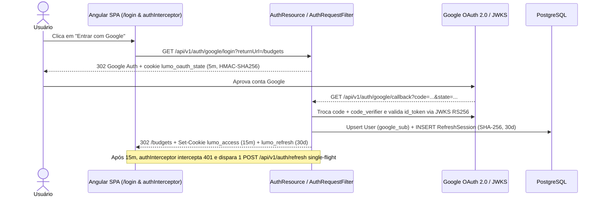
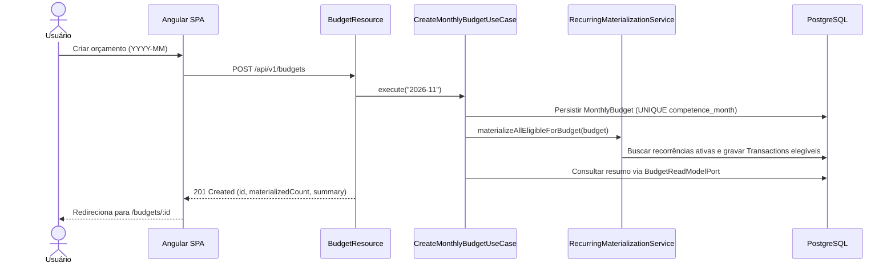
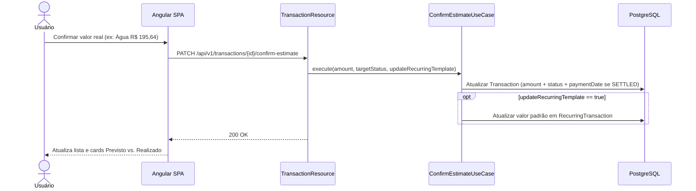

# Fluxos e Diagramas de Sequência

## 1. Autenticação Google OAuth 2.0 (PKCE) e Renovação Silenciosa (`AD-011`)

## 2. Criação de Orçamento Mensal + Materialização Automática

## 2. Confirmação de Estimativa + Atualização Opcional de Template

