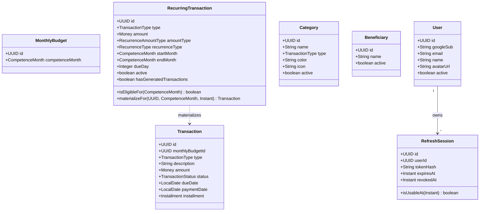
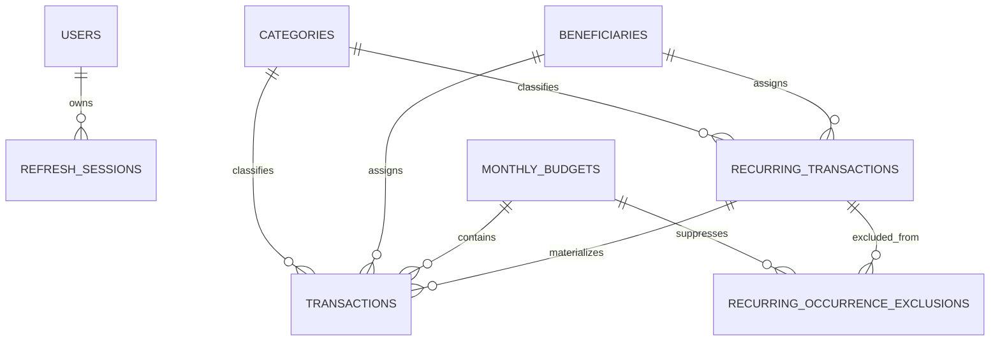
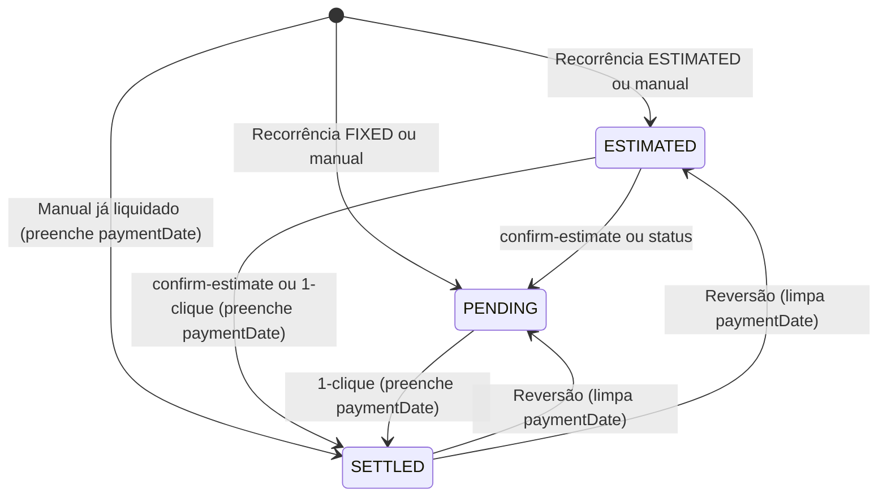

# Modelo de Domínio e Dados

## 1. Diagrama de Classes / Agregados

## 2. Modelo de Persistência (ER PostgreSQL)

## 3. Índices e Constraints Principais

- `users`: `UNIQUE (google_sub)` (`uq_users_google_sub`), `UNIQUE (email)` (`uq_users_email`)
- `refresh_sessions`: `UNIQUE (token_hash)` (`uq_refresh_sessions_token_hash`), `FK user_id -> users(id) ON DELETE CASCADE`, índices `idx_refresh_sessions_user_id` e `idx_refresh_sessions_expires_at`

- `categories`: `UNIQUE (LOWER(name), type)`
- `beneficiaries`: `UNIQUE (LOWER(name))`
- `monthly_budgets`: `UNIQUE (competence_month)`, `CHECK (competence_month ~ '^[0-9]{4}-(0[1-9]|1[0-2])$')`
- `transactions`:
  - `uq_transactions_budget_recurring`: índice único parcial `UNIQUE (monthly_budget_id, source_recurring_transaction_id) WHERE source_recurring_transaction_id IS NOT NULL`
  - `idx_transactions_budget_type_status`: `(monthly_budget_id, type, status)`
  - `idx_transactions_budget_order`: `(monthly_budget_id, due_date ASC NULLS LAST, created_at ASC)`
- `recurring_occurrence_exclusions`: `PRIMARY KEY (monthly_budget_id, recurring_transaction_id)` com `ON DELETE CASCADE`.

## 4. Máquina de Estados (`TransactionStatus`)

